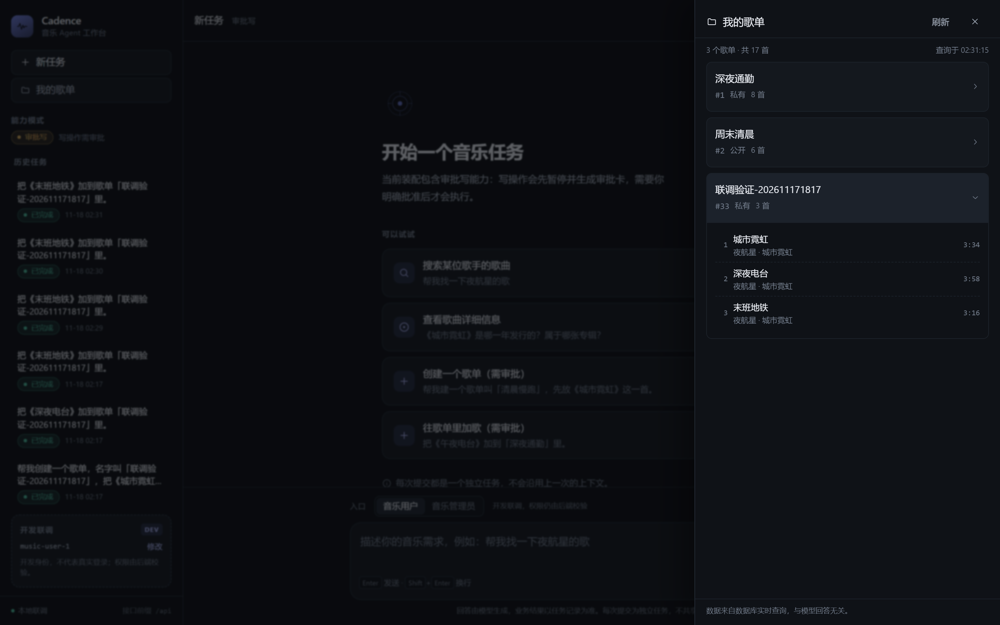

# mk-agent

一个基于 **Spring AI + Spring AI Alibaba（DashScope）** 的 Java Agent 学习项目：从最简单的聊天应用（chatApp，AI 学习知识咨询助手 + RAG 知识库）出发，逐步实现了一个具备 **ReAct 循环、工具调用、SSE 流式输出、状态机、任务取消、弹性限流、任务持久化** 的通用智能体（MkManus），并配套 RAG 知识库问答与 MCP 工具生态。

> 定位：个人学习项目，代码中有大量中文注释解释原理，适合一起"手撕"学习。

---

## 技术栈

| 类别 | 技术 |
| --- | --- |
| 语言 / 运行时 | Java 21 |
| 框架 | Spring Boot 3.4.5、Spring MVC、WebFlux（仅流式响应） |
| AI | Spring AI 1.0.0、Spring AI Alibaba 1.0.0.2（DashScope 通义千问） |
| 协议 | MCP（Model Context Protocol） |
| 数据 | PostgreSQL + pgvector（向量检索）、MyBatis-Plus（任务记录） |
| 文档 | Knife4j / SpringDoc OpenAPI |
| 其他 | Lombok、Hutool、Jsoup、iText（PDF 生成）、Kryo（对话记忆序列化） |

---

## 核心功能

### 1. MkManus 通用智能体

分层架构，每一层只关心一件事：

```
BaseAgent          Agent Loop 骨架：循环控制、步数/工具预算、超时、状态流转、注册/清理
  └─ ReActAgent    Think-Act 模式：think() 决策 + act() 执行
      └─ ToolCallAgent   工具调用：解析模型 ToolCall、执行工具、结果写回上下文
          └─ MkManus     具体智能体：系统提示词 + 工具集配置
```

- **任务状态机**：`IDLE / RUNNING / SUCCEEDED / FAILED / CANCELLED / TIMED_OUT / MAX_STEPS_REACHED`，
  终态一经写入不可覆盖（`AgentRunContext.transitionTo` 统一入口）
- **异步 + SSE**：Agent Loop 在 `agent-*` 后台线程池执行，通过 `SseEmitter` 实时推送
  `status / run_id / step / tool_start / tool_result / final_answer / done / error / cancelled` 事件
- **主动取消**：运行中任务注册到进程内注册表（`AgentTaskRegistry`），
  通过 `POST /api/ai/manus/{runId}/cancel` 取消；配合执行线程显式中断 + 循环头中断检测，
  取消后不再进入新的 step
- **任务持久化**：任务记录落库（`agent_run` 表），支持按 runId 查询与分页查询历史

### 1.1 音乐业务 Agent（M2，进行中）

同一套 `ToolCallAgent` 骨架，按 `AgentType` 收窄工具白名单：

| 入口 | AgentType | 工具 |
| --- | --- | --- |
| `GET /api/ai/music/chat` | `MUSIC_USER` | 曲库检索、歌曲详情、我的歌单、歌单曲目 |
| `GET /api/ai/music/admin/chat` | `MUSIC_ADMIN` | 曲库检索、歌曲详情、播放统计、歌曲排行（**无**歌单工具） |

- 身份由 `X-User-Id` 占位提供，角色只认 `music_user` 表；未知用户 403
- 工具里**没有** `userId` 参数，身份来自服务端固化的 `AgentRunContextHolder`
- 写工具（建歌单、加歌）已实现但**不在任何白名单**，M3 接审批后才开放
- 详见 [`docs/music-agent.md`](docs/music-agent.md) 与
  [`docs/music-permissions.md`](docs/music-permissions.md)

> ⚠️ 当前没有真实认证，`X-User-Id` 可以伪造。这是占位方案，
> 不是安全边界——接入 JWT / 网关后由拦截器替换解析逻辑。

### 2. 弹性与成本控制（resilience）

| 机制 | 说明 |
| --- | --- |
| 全局并发保护 | `AgentConcurrencyGuard`（Semaphore），限制同时运行的 Agent 任务数 |
| 用户级限流 | `AgentRequestRateLimiter`，每分钟固定窗口限流，超限返回 429 |
| 工具安全重试 | `ToolRetryWrapper`，只对白名单中的只读幂等工具（如搜索/抓取）自动重试 |
| 模型健康检查 | `AiModelHealthIndicator`，接入 Spring Actuator `/health` |

### 3. chatApp AI 学习咨询助手 + RAG 知识库

- 基础对话（含文件级对话记忆 `FileBasedChatMemory`）、结构化输出（AI 学习报告）
- 知识库内容覆盖 AI 学习三阶段：入门篇（学习路线/数学基础/提示词）、进阶篇（LLM/Transformer/RAG/向量库）、实践篇（Spring AI/Agent/工程调优），按文件名后缀映射为 `status` 元数据过滤检索范围
- 三种 RAG 知识库构建方式对比：
  1. 本地 Markdown 分片 + 内存向量库（SimpleVectorStore）
  2. 阿里云百炼云端知识库 Advisor
  3. 自定义检索增强：查询改写（`QueryRewriter`）+ 关键词元数据富集（`MyKeywordEnricher`）+ 元数据过滤 + 上下文增强
- pgvector 云端向量库配置（1536 维、HNSW 索引、余弦距离）

### 4. 工具与 MCP

内置工具（`tools/`）：网络搜索、网页抓取、文件读写、PDF 生成、资源下载、任务终止。

MCP 生态：

- `mk-image-search-mcp-server`（仓库内子模块）：图片搜索 MCP Server，
  支持 stdio / SSE 两种传输，对接 Pexels 图库
- 主程序通过 `spring-ai-starter-mcp-client` 接入 MCP 工具

---

## 项目结构

```
mk-agent
├── src/main/java/com/example/mkagent
│   ├── agent/          # Agent 核心：BaseAgent/ReActAgent/ToolCallAgent/MkManus、任务注册与取消
│   ├── app/            # chatApp AI 学习咨询助手
│   ├── rag/            # RAG 三种构建方式 + pgvector 配置
│   ├── tools/          # 内置工具（搜索/抓取/文件/PDF/下载）
│   ├── resilience/     # 并发保护、限流、工具重试
│   ├── service/        # AgentRun 任务记录服务（MyBatis-Plus）
│   ├── controller/     # AiController（对话/Agent/取消）、AgentRunController（历史查询）
│   ├── context/        # 用户身份（X-User-Id 请求头）
│   ├── model/          # AgentState 状态机、AgentRunContext、事件模型
│   ├── chatmemory/     # 基于文件的对话记忆（Kryo 序列化）
│   └── demo/           # 三种调用方式对比 demo（SDK/Spring AI/LangChain4j）
├── src/main/resources
│   ├── document/       # RAG 知识库原始 Markdown（AI 学习：入门/进阶/实践）
│   ├── db/schema.sql   # agent_run 建表脚本（幂等）
│   └── mcp-servers.json        # 本地 MCP 服务配置（含密钥，已忽略不上传）
├── mk-image-search-mcp-server/ # 图片搜索 MCP Server 子模块
├── docs/agent-learning/        # 学习文档（状态机与任务取消等）
└── src/test/           # 单元测试 + 集成测试（不依赖真实模型与外部服务）
```

---

## 快速开始

### 环境要求

- JDK 21、Maven（可用仓库自带的 `mvnw`）
- Node.js（如需运行高德地图 MCP）
- PostgreSQL（可先用本地库，建表脚本会自动执行）

### 1. 配置本地密钥

仓库里**不含任何明文密钥**。配置分三层：

| 层 | 位置 | 入库 | 打包 | 放什么 |
| --- | --- | --- | --- | --- |
| 公共默认 | `src/main/resources/application.yml` | 是 | 是 | 端口、预算、重试、限流、模型名等非敏感配置 |
| 本地差异 | `src/main/resources/application-local.yml` | 是 | 是 | 非敏感本地值 + `${ENV:default}` 占位符，**无真实值** |
| 真实密钥 | 环境变量，或仓库根 `config/application-local.yml` | 否 | 否 | 见下表 |

真实密钥的取值分**两层**，混在一起说会得到错误结论（实测见
`ModelCredentialSourcePriorityTest`）：

**① 属性来源（谁定义了这个属性，高 → 低）**

1. 命令行参数（`--spring.ai.dashscope.api-key=...`，仅临时排查用）
2. 仓库根 `config/application-local.yml`（Spring Boot 的 `file:./config/` 位置，已被忽略）
3. classpath 模板 `src/main/resources/application-local.yml`

自定义别名（`MKAGENT_*`）**不在这一层**：它只是模板占位符的输入（见 ②）。
直接绑定目标属性的环境变量（如 `SPRING_AI_DASHSCOPE_API_KEY`）是独立属性源，
按 Spring 常规优先级参与（高于 config data 文件）。

**② 占位符后备（模板这一层怎么取值）**

模板里写的是 `${MKAGENT_MODEL_API_KEY:${AI_DASHSCOPE_API_KEY:}}`：
变量**未定义**才回退到下一个；变量**定义为空串不会回退**，最终按未配置处理（启动失败）。

> **最容易踩的一条**：外部 `config/application-local.yml` 里如果直接写了
> `spring.ai.dashscope.api-key: <真实值>`，classpath 模板里那条
> `${MKAGENT_MODEL_API_KEY:${AI_DASHSCOPE_API_KEY:}}` 会被**整条替换**，
> 该占位符不再参与解析，于是 `MKAGENT_MODEL_API_KEY` 这个**别名**失去作用。
> 失效的是别名，不是环境变量这一层：**直接绑定目标属性**的环境变量
> （如 `SPRING_AI_DASHSCOPE_API_KEY`）仍按 Spring 属性源优先级生效，
> 且高于 config data 文件。要用别名，就别在外部文件里写同名属性。

| 环境变量 | 用途 | 对应属性 |
| --- | --- | --- |
| `MKAGENT_MODEL_API_KEY` | 大模型调用 | `spring.ai.dashscope.api-key`（或 `mkagent.model.api-key`） |
| `MKAGENT_SEARCH_API_KEY` | 网页搜索 | `search-api.api-key` |
| `MKAGENT_DB_PASSWORD` | 数据库口令 | `spring.datasource.password` |
| `MKAGENT_PEXELS_API_KEY` | 图片搜索子模块 | `pexels.api-key` |

可选覆盖：`MKAGENT_DB_URL`、`MKAGENT_DB_USERNAME`、`MKAGENT_CHAT_MODEL`。

> 凭据缺失时应用**启动即失败**，并打印该设哪个环境变量；
> 不会退化成"跑起来但第一次调用才 401"。

### 1.1 四种运行方式

| 场景 | 怎么给配置 |
| --- | --- |
| 本地 IDE 运行 | Run Configuration 里加环境变量；或建 `config/application-local.yml`（工作目录须为仓库根） |
| `./mvnw test` | 什么都不用做：`test` profile + H2 + 占位密钥，**不读真实凭据** |
| 真实评测（`-Plive`） | 激活 `local` profile，读 classpath 模板 + 环境变量 / `config/application-local.yml` |
| `java -jar` | 环境变量；或 `--spring.config.additional-location=file:/etc/mk-agent/` |

> 不要把密钥写进启动脚本、`.mvn/jvm.config` 或 `pom.xml`：
> 构建期变量有可能被 resource filtering 展开并打进产物（本仓库已关闭 filtering，
> 详见 [`docs/SECURITY.md`](docs/SECURITY.md) 第 7 节）。

### 2. 启动

```bash
# 主程序（端口 8123，上下文路径 /api）
./mvnw spring-boot:run

# 图片搜索 MCP Server（端口 8127，可选）
cd mk-image-search-mcp-server && ./mvnw spring-boot:run
```

### 2.1 本地演示：V1 闭环（推荐第一次这样跑）

不依赖 PostgreSQL、不依赖 MCP，数据库是 H2 文件库，**重启不丢数据**。

```bash
# 终端 1：后端（demo profile，需要真实模型凭据）
#   只在本终端设置，不要写进脚本或仓库
export MKAGENT_MODEL_API_KEY=<你的 DashScope Key>
./mvnw -Pdemo spring-boot:run -Dspring-boot.run.profiles=demo

# 终端 2：前端
cd web
npm install     # 首次
npm run dev     # http://localhost:5173
```

打开 `http://localhost:5173`，左下角应显示开发联调身份 `music-user-1`，
顶部能力徽标应显示 **审批写**（该值来自后端 `GET /ai/music/capabilities`，
不是前端写死的）。

演示脚本（一条走完就算验收）：

1. 输入「帮我找一下夜航星的歌」→ 看真实曲库结果；
2. 输入「帮我建一个歌单叫「清晨慢跑」，先放《城市霓虹》这一首」→ 出现审批卡；
3. 点**批准** → 任务继续执行，返回创建结果；
4. 左侧「我的歌单」→ 点**刷新** → 看到「清晨慢跑」和它的曲目；
5. 输入「把《深夜电台》加到「清晨慢跑」里」→ 再次审批 → 批准 → 刷新可见 2 首；
6. 任一步点**拒绝** → 数据库里不会出现对应改动（可点刷新核对）。

要点：

- 数据在 `./tmp/demo-db/`（H2 文件，`tmp/` 已忽略）。删掉该目录即重置为种子数据。
- 种子数据：3 个用户（`music-user-1` / `music-user-2` / `music-admin-1`）、
  60 首歌、3 个歌单、30 条播放记录，全部虚构。
- 演示模式的差异只有"数据库 + 打开写工具 + 关掉 RAG/MCP"，
  审批、归属校验、幂等与事务与生产完全一致。
- 生产默认仍是只读：`mkagent.agent.music.write-enabled=false`，
  模型拿不到写工具，提示词也用只读版本。

三个界面状态（真实运行截图，身份 `music-user-1`，模型 `qwen-plus`）：

| 待审批 | 批准后（真实完成） | 我的歌单（数据库查询） |
| --- | --- | --- |
|  |  |  |

注意：点「批准」之后，审批卡要等模型写完最终回答才会从"等待恢复"变成
"恢复执行已结束"（实测 2–8 秒，取决于模型）。这段时间里左侧步骤、
最终回答和「我的歌单」已经是真实结果，以它们为准；卡片状态只是晚一步。

### 3. 接口文档

启动后访问：`http://localhost:8123/api/doc.html`（Knife4j）

---

## API 一览

| 接口 | 说明 |
| --- | --- |
| `GET /api/ai/chat_app/chat/sync` | 同步对话 |
| `GET /api/ai/chat_app/chat/sse` | 流式对话（Flux 直出） |
| `GET /api/ai/chat_app/chat/events` | 流式对话（ServerSentEvent 包装） |
| `GET /api/ai/chat_app/chat/sse/emitter` | 流式对话（SseEmitter 手动推送） |
| `GET /api/ai/manus/chat?message=...` | Agent 任务（SSE），需请求头 `X-User-Id` |
| `GET /api/ai/music/chat?message=...` | 音乐助手（`MUSIC_USER`），需 `X-User-Id`，用户须在 `music_user` 表中 |
| `GET /api/ai/music/admin/chat?message=...` | 音乐统计（`MUSIC_ADMIN`），角色必须是 ADMIN |
| `GET /api/ai/music/playlists` | 当前用户自己的歌单（含歌曲数），页面"我的歌单"用 |
| `GET /api/ai/music/playlists/{id}/songs` | 某个本人歌单的曲目（非本人 → 404） |
| `GET /api/ai/music/capabilities` | 当前装配是否开放审批写 + 提示词版本 |
| `POST /api/ai/manus/{runId}/cancel` | 主动取消运行中的 Agent 任务（音乐任务沿用此接口，仅本人可取消） |
| `GET /api/ai/runs/{runId}` | 查询任务详情 |
| `GET /api/ai/runs/page` | 分页查询任务历史 |

Agent 任务 SSE 事件流示例：

```
event:status     Agent 已开始执行
event:run_id     任务ID（用于后续取消/查询）
event:step       每一步的执行摘要
event:final_answer  最终回答
event:done       [DONE]
```

---

## 测试

默认 `mvn test` 不触网、不花钱：需要真实模型 / 真实搜索 / 真实数据库的测试统一标了
`@Tag("live")`，由 surefire 默认排除（`mkagent.test.excluded-groups=live`）。

```bash
# 默认：只跑确定性测试（桩模型 / 假工具）
./mvnw test

# 状态机单元测试（11 个：成功/超时/取消/预算/清理幂等/注册移除）
./mvnw test "-Dtest=AgentStateMachineUnitTest"

# 取消接口集成测试（真实 HTTP + 假模型）
./mvnw test "-Dtest=AgentTaskCancelIntegrationTest"

# 异步 SSE 工具调用全链路集成测试
./mvnw test "-Dtest=MkManusAsyncSseIntegrationTest"

# 音乐入口：访问控制 + 端到端（桩模型，不联网）
./mvnw test "-Dtest=MusicEndpointAccessControlTest,MusicAgentSseIntegrationTest"

# live 测试：显式打开分组才会真实调用模型 / 搜索 API / 数据库
./mvnw -Plive test "-Dtest=MkManusTest"
```

---

## 学习文档

`docs/agent-learning/` 目录记录每次功能演进的"手撕"过程：

- `02-agent-state-and-task-cancel.md`：Agent 状态机、任务注册表、主动取消与超时处理
  （含状态流转图、四条路径时序图、面试题与常见问题排查表）

其它专题文档：

- [`docs/agent-eval.md`](docs/agent-eval.md)：离线评测（33 条用例、确定性检查 + 引用真实性校验 + LLM-as-judge、整轮预算保护）
- [`docs/SECURITY.md`](docs/SECURITY.md)：安全加固（SSRF 校验、密钥管理、会话 ID 校验）
- [`docs/COST.md`](docs/COST.md)：成本控制（RAG 延迟初始化、模型重试策略与取舍、工具重试耗尽与站点级熔断、评测预算、模型分层、工具配置/输出上限/日志治理、任务轨迹落库与预算耗尽收尾）
- [`docs/music-agent.md`](docs/music-agent.md)：音乐业务 Agent（M2）——六张业务表、种子数据、只读工具、两个入口、手动冒烟脚本
- [`docs/music-permissions.md`](docs/music-permissions.md)：音乐权限矩阵——工具 × AgentType × 数据范围 × 三道防线
- [`docs/music-idempotency-research.md`](docs/music-idempotency-research.md)：写工具幂等键调研（Spring AI 1.0.0 不传 toolCallId，改用服务端派生键）

---

## 安全说明

- 所有密钥通过环境变量 / `config/application-local.yml` 注入，仓库中不含任何明文密钥
- `config/application-local.yml`、`mcp-servers.json` 已加入 `.gitignore`；
  `src/main/resources/application-local.yml` 已入库但只有占位符（见第 7 节安全文档）
- 打包产物不含明文密钥：构建期关闭了 resource filtering，
  `ResourceSecretScanUnitTest` 会扫描资源目录并逐字节校验 classpath 副本

---

## License

仅供学习交流。
