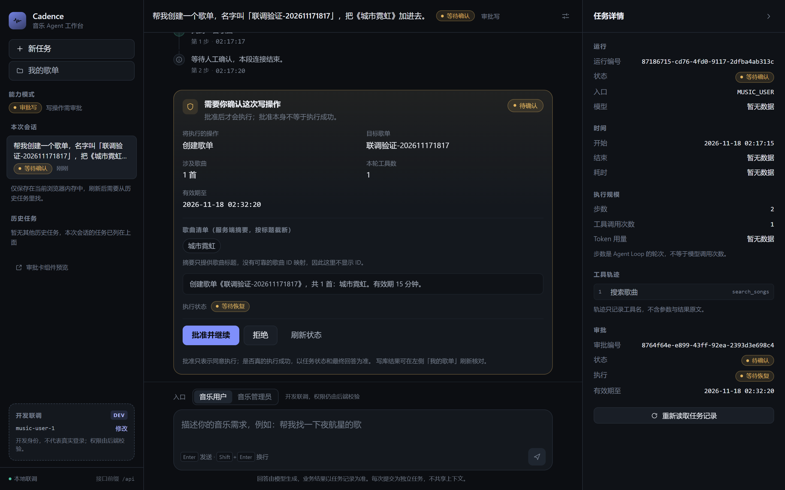
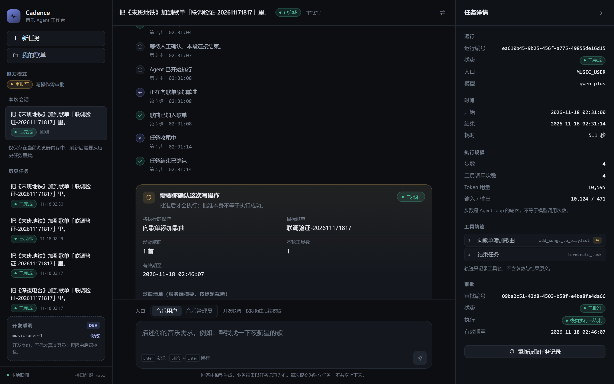

# mk-agent

一个基于 **Spring AI + Spring AI Alibaba（DashScope）** 的 Java Agent 学习项目：从最简单的聊天应用（chatApp，AI 学习知识咨询助手 + RAG 知识库）出发，逐步实现了一个具备 **ReAct 循环、工具调用、SSE 流式输出、状态机、任务取消、弹性限流、任务持久化** 的通用智能体（MkManus），并配套 RAG 知识库问答与 MCP 工具生态。

> 定位：个人学习项目，代码中有大量中文注释解释原理，适合一起"手撕"学习。

---

## 技术栈

| 类别 | 技术 |
| --- | --- |
| 语言 / 运行时 | Java 21 |
| 框架 | Spring Boot 3.4.5、Spring MVC、WebFlux（仅流式响应） |
| AI | Spring AI 1.0.0、Spring AI Alibaba 1.0.0.2（DashScope 通义千问） |
| 协议 | MCP（Model Context Protocol） |
| 数据 | PostgreSQL + pgvector（向量检索）、MyBatis-Plus（任务记录） |
| 文档 | Knife4j / SpringDoc OpenAPI |
| 其他 | Lombok、Hutool、Jsoup、iText（PDF 生成）、Kryo（对话记忆序列化） |

---

## 核心功能

### 1. MkManus 通用智能体

分层架构，每一层只关心一件事：

```
BaseAgent          Agent Loop 骨架：循环控制、步数/工具预算、超时、状态流转、注册/清理
  └─ ReActAgent    Think-Act 模式：think() 决策 + act() 执行
      └─ ToolCallAgent   工具调用：解析模型 ToolCall、执行工具、结果写回上下文
          └─ MkManus     具体智能体：系统提示词 + 工具集配置
```

- **任务状态机**：`IDLE / RUNNING / SUCCEEDED / FAILED / CANCELLED / TIMED_OUT / MAX_STEPS_REACHED`，
  终态一经写入不可覆盖（`AgentRunContext.transitionTo` 统一入口）
- **异步 + SSE**：Agent Loop 在 `agent-*` 后台线程池执行，通过 `SseEmitter` 实时推送
  `status / run_id / step / tool_start / tool_result / final_answer / done / error / cancelled` 事件
- **主动取消**：运行中任务注册到进程内注册表（`AgentTaskRegistry`），
  通过 `POST /api/ai/manus/{runId}/cancel` 取消；配合执行线程显式中断 + 循环头中断检测，
  取消后不再进入新的 step
- **任务持久化**：任务记录落库（`agent_run` 表），支持按 runId 查询与分页查询历史

### 1.1 音乐业务 Agent（M2，进行中）

同一套 `ToolCallAgent` 骨架，按 `AgentType` 收窄工具白名单：

| 入口 | AgentType | 工具 |
| --- | --- | --- |
| `GET /api/ai/music/chat` | `MUSIC_USER` | 曲库检索、歌曲详情、我的歌单、歌单曲目 |
| `GET /api/ai/music/admin/chat` | `MUSIC_ADMIN` | 曲库检索、歌曲详情、播放统计、歌曲排行（**无**歌单工具） |

- 身份由 `X-User-Id` 占位提供，角色只认 `music_user` 表；未知用户 403
- 工具里**没有** `userId` 参数，身份来自服务端固化的 `AgentRunContextHolder`
- 写工具（建歌单、加歌）已实现但**不在任何白名单**，M3 接审批后才开放
- 详见 [`docs/music-agent.md`](docs/music-agent.md) 与
  [`docs/music-permissions.md`](docs/music-permissions.md)

> ⚠️ 当前没有真实认证，`X-User-Id` 可以伪造。这是占位方案，
> 不是安全边界——接入 JWT / 网关后由拦截器替换解析逻辑。

### 1.2 商城（A0：最小商城 + 订单 + 发货出库）

买家在浏览器真实下单，后台演示发货与签收，系统保存订单、库存余额和出库流水。

- **入口**：`/shop`（买家）、`/shop/admin`（后台），与音乐模块并列，不塞进歌曲页
- **状态机**：`待发货 → 已发货 → 已签收`，三条边，由 `CHECK` 约束钉在数据库里
- **下单不预占库存**：下单只写订单 + 明细；**发货才校验并扣减**，四件事
  （校验角色与状态、扣库存、写出库流水、改订单状态）在同一个事务里
- **并发与重复**：订单行锁 + 原子条件更新（`WHERE available >= ?`）+ `CHECK (available >= 0)`
  + `UNIQUE (order_item_id, movement_type)`，重复发货返回 `applied=false`，不重复扣减
- **价格与归属由服务端决定**：下单请求体只有 `productId` + `quantity`，
  没有价格、没有 buyerId 字段可绑
- **不依赖大模型**：模型不可用或没配凭据时，商城闭环照常运行
- **两种数据库都验过**：H2（全量 841 项）+ 真实 PostgreSQL 16.15（专项 13 项，
  `./mvnw -Ppg test "-Dtest=ShopPostgres*"`）
- 详见 [`docs/shop-a0.md`](docs/shop-a0.md) 与 [`docs/shop-a0-pg.md`](docs/shop-a0-pg.md)

> 演示付款：`payment_mode = 'DEMO'`，没有真实资金交易、没有退款、没有物流。
> 售后（A1）已实施，见 1.3；B（客服审批 / 仓库验收 / 退货入库 / 退款）仍未实施。

### 1.3 售后（A1：退货申请 + 售后 Agent）

买家可以对**已签收**的订单申请退货（支持部分数量），普通表单与售后 Agent
写的是同一套 Java 服务。本轮只做到 **「已提交、可查」**。

- **入口**：`/shop/aftersale`（对话 + 可退订单 + 表单 + 我的售后）；
  对话走 `GET /api/ai/aftersale/chat`
- **状态只有一种**：`SUBMITTED`（已提交）。数据库 `CHECK` 钉住，
  写不出「已批准 / 已退款」
- **额度三算**：已购 / 已占用 / 剩余可退，全部服务端算；A1 里只有"已提交"的申请占额度，
  客服驳回与释放额度留到 B 阶段
- **不超卖**：订单行 `SELECT … FOR UPDATE` + 原子条件更新
  `WHERE reserved_qty + ? <= quantity_total` + `CHECK (reserved_qty <= quantity_total)` 兜底；
  额度占用与建单在**同一个事务**里，占用后建单失败整体回滚
- **两套幂等**：表单用 `clientRequestId`（重试沿用、改参数换新），
  Agent 用框架的 `runId + step + toolCallId`；同键同参数返回原单，同键不同参数 409
- **确认卡固定五项**：订单号 / 商品 / 数量 / 预计退款 / 原因。
  确认前不建单、不占额度；拒绝或取消**零写入**；预览**不是**资格凭证，
  执行时会重新校验归属与额度
- **不碰库存**：A1 不改可售库存、不写退货入库流水
- **不依赖大模型**：模型不可用时普通表单照常提交与查询
- **两种数据库都验过**：H2（A1 专项 42 项）+ 真实 PostgreSQL 16（专项 5 项，
  `./mvnw -Ppg test "-Dtest=AfterSalePostgres*"`）
- 详见 [`docs/shop-a1.md`](docs/shop-a1.md)

> ⚠️ 本轮**不是**真实认证上线：`X-User-Id` 仍是 demo 边界内的占位方案。
> 共享部署请保持 `mkagent.shop.demo-identity-enabled=false`（默认），
> 此时售后所有入口一律 403（有测试钉住）。

### 2. 弹性与成本控制（resilience）

| 机制 | 说明 |
| --- | --- |
| 全局并发保护 | `AgentConcurrencyGuard`（Semaphore），限制同时运行的 Agent 任务数 |
| 用户级限流 | `AgentRequestRateLimiter`，每分钟固定窗口限流，超限返回 429 |
| 工具安全重试 | `ToolRetryWrapper`，只对白名单中的只读幂等工具（如搜索/抓取）自动重试 |
| 模型健康检查 | `AiModelHealthIndicator`，接入 Spring Actuator `/health` |

### 3. chatApp AI 学习咨询助手 + RAG 知识库

- 基础对话（含文件级对话记忆 `FileBasedChatMemory`）、结构化输出（AI 学习报告）
- 知识库内容覆盖 AI 学习三阶段：入门篇（学习路线/数学基础/提示词）、进阶篇（LLM/Transformer/RAG/向量库）、实践篇（Spring AI/Agent/工程调优），按文件名后缀映射为 `status` 元数据过滤检索范围
- 三种 RAG 知识库构建方式对比：
  1. 本地 Markdown 分片 + 内存向量库（SimpleVectorStore）
  2. 阿里云百炼云端知识库 Advisor
  3. 自定义检索增强：查询改写（`QueryRewriter`）+ 关键词元数据富集（`MyKeywordEnricher`）+ 元数据过滤 + 上下文增强
- pgvector 云端向量库配置（1536 维、HNSW 索引、余弦距离）

### 4. 工具与 MCP

内置工具（`tools/`）：网络搜索、网页抓取、文件读写、PDF 生成、资源下载、任务终止。

MCP 生态：

- `mk-image-search-mcp-server`（仓库内子模块）：图片搜索 MCP Server，
  支持 stdio / SSE 两种传输，对接 Pexels 图库
- 主程序通过 `spring-ai-starter-mcp-client` 接入 MCP 工具

---

## 项目结构

```
mk-agent
├── src/main/java/com/example/mkagent
│   ├── agent/          # Agent 核心：BaseAgent/ReActAgent/ToolCallAgent/MkManus、任务注册与取消
│   ├── shop/           # 商城 A0：catalog（商品）/ order（订单）/ inventory（库存与流水）
│   ├── app/            # chatApp AI 学习咨询助手
│   ├── rag/            # RAG 三种构建方式 + pgvector 配置
│   ├── tools/          # 内置工具（搜索/抓取/文件/PDF/下载）
│   ├── resilience/     # 并发保护、限流、工具重试
│   ├── service/        # AgentRun 任务记录服务（MyBatis-Plus）
│   ├── controller/     # AiController（对话/Agent/取消）、AgentRunController（历史查询）
│   ├── context/        # 用户身份（X-User-Id 请求头）
│   ├── model/          # AgentState 状态机、AgentRunContext、事件模型
│   ├── chatmemory/     # 基于文件的对话记忆（Kryo 序列化）
│   └── demo/           # 三种调用方式对比 demo（SDK/Spring AI/LangChain4j）
├── src/main/resources
│   ├── document/       # RAG 知识库原始 Markdown（AI 学习：入门/进阶/实践）
│   ├── db/schema.sql   # agent_run 建表脚本（幂等）
│   └── mcp-servers.json        # 本地 MCP 服务配置（含密钥，已忽略不上传）
├── mk-image-search-mcp-server/ # 图片搜索 MCP Server 子模块
├── docs/agent-learning/        # 学习文档（状态机与任务取消等）
└── src/test/           # 单元测试 + 集成测试（不依赖真实模型与外部服务）
```

---

## 快速开始

### 环境要求

- JDK 21、Maven（可用仓库自带的 `mvnw`）
- Node.js（如需运行高德地图 MCP）
- PostgreSQL（可先用本地库，建表脚本会自动执行）

### 1. 配置本地密钥

仓库里**不含任何明文密钥**。配置分三层：

| 层 | 位置 | 入库 | 打包 | 放什么 |
| --- | --- | --- | --- | --- |
| 公共默认 | `src/main/resources/application.yml` | 是 | 是 | 端口、预算、重试、限流、模型名等非敏感配置 |
| 本地差异 | `src/main/resources/application-local.yml` | 是 | 是 | 非敏感本地值 + `${ENV:default}` 占位符，**无真实值** |
| 真实密钥 | 环境变量，或仓库根 `config/application-local.yml` | 否 | 否 | 见下表 |

真实密钥的取值分**两层**，混在一起说会得到错误结论（实测见
`ModelCredentialSourcePriorityTest`）：

**① 属性来源（谁定义了这个属性，高 → 低）**

1. 命令行参数（`--spring.ai.dashscope.api-key=...`，仅临时排查用）
2. 仓库根 `config/application-local.yml`（Spring Boot 的 `file:./config/` 位置，已被忽略）
3. classpath 模板 `src/main/resources/application-local.yml`

自定义别名（`MKAGENT_*`）**不在这一层**：它只是模板占位符的输入（见 ②）。
直接绑定目标属性的环境变量（如 `SPRING_AI_DASHSCOPE_API_KEY`）是独立属性源，
按 Spring 常规优先级参与（高于 config data 文件）。

**② 占位符后备（模板这一层怎么取值）**

模板里写的是 `${MKAGENT_MODEL_API_KEY:${AI_DASHSCOPE_API_KEY:}}`：
变量**未定义**才回退到下一个；变量**定义为空串不会回退**，最终按未配置处理（启动失败）。

> **最容易踩的一条**：外部 `config/application-local.yml` 里如果直接写了
> `spring.ai.dashscope.api-key: <真实值>`，classpath 模板里那条
> `${MKAGENT_MODEL_API_KEY:${AI_DASHSCOPE_API_KEY:}}` 会被**整条替换**，
> 该占位符不再参与解析，于是 `MKAGENT_MODEL_API_KEY` 这个**别名**失去作用。
> 失效的是别名，不是环境变量这一层：**直接绑定目标属性**的环境变量
> （如 `SPRING_AI_DASHSCOPE_API_KEY`）仍按 Spring 属性源优先级生效，
> 且高于 config data 文件。要用别名，就别在外部文件里写同名属性。

| 环境变量 | 用途 | 对应属性 |
| --- | --- | --- |
| `MKAGENT_MODEL_API_KEY` | 大模型调用 | `spring.ai.dashscope.api-key`（或 `mkagent.model.api-key`） |
| `MKAGENT_SEARCH_API_KEY` | 网页搜索 | `search-api.api-key` |
| `MKAGENT_DB_PASSWORD` | 数据库口令 | `spring.datasource.password` |
| `MKAGENT_PEXELS_API_KEY` | 图片搜索子模块 | `pexels.api-key` |

可选覆盖：`MKAGENT_DB_URL`、`MKAGENT_DB_USERNAME`、`MKAGENT_CHAT_MODEL`。

> 凭据缺失时应用**启动即失败**，并打印该设哪个环境变量；
> 不会退化成"跑起来但第一次调用才 401"。

### 1.1 四种运行方式

| 场景 | 怎么给配置 |
| --- | --- |
| 本地 IDE 运行 | Run Configuration 里加环境变量；或建 `config/application-local.yml`（工作目录须为仓库根） |
| `./mvnw test` | 什么都不用做：`test` profile + H2 + 占位密钥，**不读真实凭据** |
| 真实评测（`-Plive`） | 激活 `local` profile，读 classpath 模板 + 环境变量 / `config/application-local.yml` |
| `java -jar` | 环境变量；或 `--spring.config.additional-location=file:/etc/mk-agent/` |

> 不要把密钥写进启动脚本、`.mvn/jvm.config` 或 `pom.xml`：
> 构建期变量有可能被 resource filtering 展开并打进产物（本仓库已关闭 filtering，
> 详见 [`docs/SECURITY.md`](docs/SECURITY.md) 第 7 节）。

### 2. 启动

```bash
# 主程序（端口 8123，上下文路径 /api）
./mvnw spring-boot:run

# 图片搜索 MCP Server（端口 8127，可选）
cd mk-image-search-mcp-server && ./mvnw spring-boot:run
```

### 2.1 本地演示：V1 闭环（推荐第一次这样跑）

不依赖 PostgreSQL、不依赖 MCP，数据库是 H2 文件库，**重启不丢数据**。

```bash
# 终端 1：后端（demo profile，需要真实模型凭据）
#   只在本终端设置，不要写进脚本或仓库
export MKAGENT_MODEL_API_KEY=<你的 DashScope Key>
./mvnw -Pdemo spring-boot:run -Dspring-boot.run.profiles=demo

# 终端 2：前端
cd web
npm install     # 首次
npm run dev     # http://localhost:5173
```

打开 `http://localhost:5173`，左下角应显示开发联调身份 `music-user-1`，
顶部能力徽标应显示 **审批写**（该值来自后端 `GET /ai/music/capabilities`，
不是前端写死的）。

演示脚本（一条走完就算验收）：

1. 输入「帮我找一下夜航星的歌」→ 看真实曲库结果；
2. 输入「帮我建一个歌单叫「清晨慢跑」，先放《城市霓虹》这一首」→ 出现审批卡；
3. 点**批准** → 任务继续执行，返回创建结果；
4. 左侧「我的歌单」→ 点**刷新** → 看到「清晨慢跑」和它的曲目；
5. 输入「把《深夜电台》加到「清晨慢跑」里」→ 再次审批 → 批准 → 刷新可见 2 首；
6. 任一步点**拒绝** → 数据库里不会出现对应改动（可点刷新核对）。

要点：

- 数据在 `./tmp/demo-db/`（H2 文件，`tmp/` 已忽略）。删掉该目录即重置为种子数据。
- 种子数据：3 个用户（`music-user-1` / `music-user-2` / `music-admin-1`）、
  60 首歌、3 个歌单、30 条播放记录，全部虚构。
- 演示模式的差异只有"数据库 + 打开写工具 + 关掉 RAG/MCP"，
  审批、归属校验、幂等与事务与生产完全一致。
- 生产默认仍是只读：`mkagent.agent.music.write-enabled=false`，
  模型拿不到写工具，提示词也用只读版本。

三个界面状态（真实运行截图，身份 `music-user-1`，模型 `qwen-plus`）：

| 待审批 | 批准后（真实完成） | 我的歌单（数据库查询） |
| --- | --- | --- |
|  |  |  |

注意：点「批准」之后，审批卡要等模型写完最终回答才会从"等待恢复"变成
"恢复执行已结束"（实测 2–8 秒，取决于模型）。这段时间里左侧步骤、
最终回答和「我的歌单」已经是真实结果，以它们为准；卡片状态只是晚一步。

### 2.2 同一会话连续聊天

一个会话里的多轮共享上下文，**但每一轮仍是独立的 run**（新 runId，
绝不复活已终态的 run）。三个 ID 的边界：

| 概念 | 含义 | 何时变化 |
| --- | --- | --- |
| `conversationId` | 会话：一个窗口里的连续多轮 | 只在点「新建会话」时新建 |
| `runId` | 一次用户提交（一轮） | **每轮新建** |
| `epoch` | 某个 run 的执行代次 | 审批恢复时 +1（既有机制） |

模型看到的是三样东西，都来自服务端：

1. 当前系统提示词；
2. 最近 **6 条**（约 3 轮）用户/助手**文本**，单条截断到 800 字；
3. 一段"会话已知对象"：最近一次**搜索**到的歌曲（按返回顺序，带真实 ID）、
   最近创建/确认的歌单、当前用户的歌单列表。它由工具返回的信封 JSON 解析，
   **不从模型回答里正则抠 ID**。

会话里没有工具调用记录：回放旧的 tool_call 会让模型把历史指令当本轮指令
再执行一次（"把前两首建歌单"被重放成再建一次）。

演示（延续 2.1 的环境，同一个页面）：

1. 「查一下夜航星的歌」→ 5 首；
2. 直接问「第一首是哪一年发行的？」→ 同一窗口里模型能答（2021）；
3. 点「新建会话」再问同一句 → 模型会明确说不知道指的是哪一首（上下文不串）；
4. 点左侧回到第 1 个会话，说「把前两首歌建一个歌单，名字叫「夜航星精选」」
   → 审批卡 → 批准 → 歌单真的落库；
5. 说「把刚才第三首也加进去」→ 审批卡 → 批准 → 曲目变成 3 首；
6. 换一首不在歌单里的歌说「再加《深夜电台》」→ 点**拒绝** → 曲目不变，
   回答会写明是你拒绝的；
7. 刷新整页 → 会话自动回到原来那个，消息、审批结论与歌单都还在。

要点与已知限制：

- **同一会话不允许并发**：还有执行中或待审批的任务时，输入框上方会给出提示，
  后端也会返回 409。跨会话互不影响。
- 会话消息只存"用户输入 + 模型最终回答"的文本；工具进度、审批卡按 run 归属，
  不会覆盖整条会话。
- 刷新后如果某轮还在等待审批，审批卡会按 `approvalId` 重建，可以直接批准/拒绝。
- 不带 `conversationId` 的老入口（`/ai/manus/chat`、直接调 `/ai/music/chat`）
  行为完全不变，历史记录不需要迁移。
- 实测模型行为（`qwen-plus`）：对"把刚才第三首也加进去"这类**指代**请求，
  它偶尔会先问一句"请确认是否继续"或只描述动作而不调用工具。
  此时回一句「确认」或把歌单名说全（「加到「夜航星精选」里」）即可继续；
  业务结果始终以数据库为准，不要以模型话术为准。

### 2.3 界面：夜间唱片室

前端是 Vue 3 + Vite 的**工作台**，不是落地页：没有 Hero、没有卡片墙、没有播放控件。

设计规则（实现见 `web/src/styles/tokens.css`）：

| 项 | 规则 |
| --- | --- |
| 底色 | 背景 `#111416` / 侧栏 `#171B1E` / 浮层 `#202529`，靠明度分层，不靠阴影 |
| 文字 | 主 `#F1F3F2`、次 `#AAB4B0`、元信息 `#7C8783`（在背景上约 4.9:1） |
| 强调色 | `#76D6B2`，只用于发送按钮、当前会话、关键操作 |
| 状态 | 等待确认=琥珀、失败=红、拒绝=中性 + 文字说明；**任何状态都不只靠颜色表达** |
| 字号 | 正文 15px / 行高 1.65；11.5 / 13 / 15 / 17 / 20 / 24 六档 |
| 间距 | 只有 4 的倍数（4/8/12/16/20/24/32…） |
| 圆角 | 只有两档：控件 8px、容器与弹层 14px（胶囊只给标签） |
| 断点 | 899px 一个：侧栏变抽屉；详情与「我的歌单」始终是覆盖式抽屉 |

布局契约（输入框不跳动的根因）：

```
外壳  grid-template-columns: 侧栏 | minmax(0, 1fr)          ← 永远两列
主区  grid-template-rows:    顶栏 | minmax(0, 1fr) | auto   ← 第三行 = 常驻播放器
工作区 grid-template-rows:   minmax(0, 1fr) | auto          ← 消息区 | 输入区
```

- 之前输入框会跳：详情面板是**第三列**（372px），空会话没有 run 时不显示该列，
  于是内容中心线在 1440px 下横向移动 **186px**（1280px 下 100px）。
  现在详情改成覆盖式抽屉，列宽恒定，实测差异 **0px**。
- 播放器是主区的**第三行**（`auto`），不浮在内容上、不进滚动区：
  它出现/消失只压缩消息区高度，不改变左右边距，也不会盖住审批卡。
  没有当前曲目时该行高度为 0，视觉上与之前完全一致。
- 输入组件挂在工作区上，不在消息列表/某一轮节点里；切换会话只换内容，不重挂载。
  播放器更在外壳层，切换会话连 DOM 都不动（`<audio>` 是 `body` 下的单例）。
- 消息区是**唯一**纵向滚动容器（`scrollbar-gutter: stable`，滚动条出现不改变宽度）；
  输入区固定底边，随内容向上长，到 200px 后在 textarea 内部滚动。
- 只有"在底部附近"才自动跟随；向上读历史时出现「回到最新」，不强制拉到底。

回归方式（都在 `web/` 下，需要后端 8123 + Vite 5173 已启动；只读接口，不调模型）：

```bash
node tools/measure-composer.mjs target/layout/after.json   # 逐视口测输入框 left/width/bottom
node tools/e2e-ui-conversation.mjs                          # 页面级 19 项断言（含截图）
node tools/shot-ui.mjs                                      # 交付截图 → target/ui
```

`e2e-ui-conversation.mjs` 会拦截 `/api/ai/music/chat` 与 `/api/ai/runs/{id}`，
用固定 SSE 帧冒充一次提交，因此**不消耗模型额度**；会话详情、审批详情走真实只读接口。

未实测：真机软键盘弹起后的可用高度、真实中文输入法选词（仅用 jsdom 单测覆盖
composition 事件）、iOS Safari 的 `dvh` 行为。验收截图取自 Chrome 桌面 1440×900、
1280×720 与移动视口 390×844。

### 2.4 播放 MVP：真实点播链路

职责分层（参考 Twilight Echo，但**不把原生音频引擎移植进 Spring Boot**）：

| 层 | 在哪 | 做什么 | 不做什么 |
| --- | --- | --- | --- |
| 音源解析 | 服务端 `playback` 包 | 曲目 → 音源映射 → 交付方式 + 短期地址 | 不解码、不转码、不代理第三方流 |
| 播放控制 | 前端 `stores/player.ts` | 播放/暂停/进度/上下首/队列/错误态 | 不碰音频数据 |
| 音频处理 | 前端 `audio/equalizer.ts` | 前级增益 + 三段 EQ + 真旁路 | 只对 `processable` 来源开放 |
| 实际输出 | 浏览器 `<audio>` | 解码与声卡输出 | 服务端不参与 |

#### 音源现状（必须说清楚）

仓库里**没有 MinIO**：`docker-compose.yml` 只有 pgvector Postgres，没有任何
`MINIO_*` / S3 配置。所以本轮没有"核对旧对象定位与权限校验"这一步可做——
旧在线音乐平台的对象定位代码不在本仓库，不猜、也不假装复用。

实际落地的音源是**项目自行生成的测试音**（`tools/generate-test-audio.py`，
16 kHz 单声道 16-bit WAV，各 10 秒，带 20 ms 淡入淡出）：

| 曲目 ID | 标题 | 文件 | 谁能播 |
| --- | --- | --- | --- |
| 1901 | 测试音 A（琶音） | `media/test-tone-a.wav` | 所有已开通用户 |
| 1902 | 测试音 B（低音） | `media/test-tone-b.wav` | 所有已开通用户 |
| 1903 | 测试音 C（受限） | `media/test-tone-b.wav` | 仅 `music-user-2`（用于越权拒绝） |

这三条是**独立曲目**（artist = `MkAgent Test Fixtures`，genre = `TEST_FIXTURE`），
不是给种子歌曲挂测试音。种子曲目 1001~1060 **没有**音源映射，
继续可搜索、可进歌单，但解析结果明确是 `NO_SOURCE`（"暂无可用音源"）。
这样评审能一眼区分"音源没接"和"接错了"——不会出现点《夜航星》听到正弦音阶的情况。

两个音色刻意做得容易分辨（A 偏高偏亮，B 偏低偏慢），便于验证切歌真的换了源。

#### 接口

```bash
# 解析（可播）
curl -s -X POST localhost:8123/api/ai/music/playback/resolve \
  -H 'X-User-Id: music-user-1' -H 'Content-Type: application/json' \
  -d '{"songId":1901}'
```

```json
{
  "playable": true,
  "song": { "id": 1901, "title": "测试音 A（琶音）", "artist": "MkAgent Test Fixtures",
            "album": "A 大调琶音，10 秒", "durationSeconds": 10, "releaseYear": 2026 },
  "mode": "DIRECT_AUDIO",
  "provider": "local-test-fixture",
  "format": "WAV",
  "contentType": "audio/wav",
  "streamUrl": "/api/ai/music/playback/media/v1.eyJzIjoxOTAxLCJ1IjoibXVzaWMtdXNlci0xIiwiZSI6MTc2MzU4NTIzNH0.9d3f…",
  "expiresAt": 1763585234,
  "capabilities": { "seek": true, "range": true, "eq": true },
  "reasonCode": null,
  "reason": null
}
```

不可播时是同一结构、`playable=false`、`mode=UNAVAILABLE`、`streamUrl=null`：

| `reasonCode` | HTTP | 含义 |
| --- | --- | --- |
| `NO_SOURCE` | 200 | 曲目存在但没有音源映射（种子曲目） |
| `MEDIA_MISSING` | 200 | 映射在、文件读不到（配置错误） |
| `PROVIDER_NOT_CONNECTED` | 200 | `PROVIDER_SDK` / `EXTERNAL_LINK`，未授权接入 |
| `SOURCE_UNAVAILABLE` | 200 | 映射被标记为不可用 |
| `TRACK_FORBIDDEN` | 403 | 音源属于别人（越权） |
| `SONG_NOT_FOUND` | 404 | 曲目不存在 |
| `PLAYLIST_NOT_FOUND` | 404 | 传了别人的 `playlistId` |

**为什么"不可播"走 200 而"越权"走 403**：前者是内容状态，页面要显示原因并让用户换一首；
后者是权限事件，必须能被日志与网关识别。混成一个码，两种问题就再也分不开了。

```bash
# 取流（Range 由服务端真实实现）
curl -s -D - -o /dev/null -H 'Range: bytes=0-99' \
  "localhost:8123/api/ai/music/playback/media/<token>"
# → 206 Partial Content
#   Accept-Ranges: bytes
#   Content-Range: bytes 0-99/320044
#   Content-Type: audio/wav
#   Cache-Control: private, no-store

# 会话内候选（点歌卡的数据来源，只取真实工具结果写进会话的引用）
curl -s "localhost:8123/api/ai/music/playback/candidates?conversationId=<id>" \
  -H 'X-User-Id: music-user-1'

# 活跃播放：客户端在真实 playing 事件后上报 START；心跳/暂停/停止带同一个 instanceId
curl -s -X POST localhost:8123/api/ai/music/playback/now-playing \
  -H 'X-User-Id: music-user-1' -H 'Content-Type: application/json' \
  -d '{"songId":1902,"event":"START","instanceId":"6f1c2a9e-..."}'

# 心跳（每 60 秒；服务端 180 秒收不到就认为不再播放）
curl -s -X POST localhost:8123/api/ai/music/playback/now-playing \
  -H 'X-User-Id: music-user-1' -H 'Content-Type: application/json' \
  -d '{"songId":1902,"event":"HEARTBEAT","instanceId":"6f1c2a9e-..."}'

# 当前有效播放：只认 PLAYING 且在 180 秒窗口内；没有则 204
curl -s -o /dev/null -w '%{http_code}\n' localhost:8123/api/ai/music/playback/now-playing \
  -H 'X-User-Id: music-user-1'
```

#### 三个刻意的设计决定

1. **`<audio src>` 不能带 `X-User-Id`**，所以媒体接口改用**签名地址**：
   `v1.<base64url(payload{s,u,e})>.<base64url(hmac)>`，HMAC-SHA256，
   绑定 `songId + userId + 过期时间`。验签失败与过期**统一返回 403**，
   不区分——否则可以用返回码探测某个 `songId` 是否存在。
   签名绑定的是**发起请求的用户**，不是音源的 owner。
   准确性质是**短期持有者凭证（bearer token）**：签名覆盖 `songId + userId + 过期时间`，
   所以拿到地址的人改不了曲目、延不了期；但**任何拿到地址的人**在有效期内都能读这一首
   （`/media` 只验签、不校验请求方身份，因为 `<audio>` 带不了业务请求头）。
   转发即等于授权，因此地址不进日志、不进模型消息、不贴进工单。
   TTL 保持 300 秒，正常播放过程中**不**主动替换 `src`（那会造成可听见的断点）。
2. **`object_key` 永不外泄**：响应里只有 `streamUrl`，没有文件路径、没有对象名。
   `MediaFileStore` 对 key 做白名单校验（`^[A-Za-z0-9._/-]{1,255}$`、拒绝 `..`），
   配置了 `media-dir` 时还要求规范化后仍在目录内。
3. **受保护文件不进公开静态目录**：媒体只在 `classpath:media/` 或配置的
   `mkagent.playback.media-dir` 下，只能经 `/media/{token}` 读。

#### 配置

```yaml
mkagent:
  playback:
    signing-secret: ${MKAGENT_PLAYBACK_SIGNING_SECRET:}   # 留空 = 进程内随机（重启后旧地址失效）
    url-ttl-seconds: 300                                   # 合法 30~3600，越界回退 300
    media-dir: ${MKAGENT_PLAYBACK_MEDIA_DIR:}              # 留空 = classpath:media/
    active-ttl-seconds: 180                                # 无心跳多久后不再算"正在播放"（客户端心跳间隔 60s）
  providers:
    demo-enabled: ${MKAGENT_PROVIDERS_DEMO_ENABLED:true}   # 只影响模拟来源
    trusted-identity: ${MKAGENT_PROVIDERS_TRUSTED_IDENTITY:false}  # 真实绑定前置条件
    timeout-ms: ${MKAGENT_PROVIDERS_TIMEOUT_MS:1500}       # 单来源读取预算
```

多实例部署必须显式配置同一个 `signing-secret`，否则 A 实例签发的地址在 B 实例上 403，
表现为"播放随机失败"。

#### 续播快照 vs 活跃播放（两件独立的事）

| | 续播快照 | 活跃播放 |
| --- | --- | --- |
| 存在哪里 | 浏览器 `localStorage`，按 MkAgent 用户隔离 | 服务端 `music_now_playing`（每用户一行） |
| 存什么 | 曲目引用 + 播放进度 + 更新时间 | 曲目、状态、实例标识、最后心跳时间 |
| 有效期 | 12 小时（`RESUME_TTL_MS`） | 180 秒无心跳即失效（服务端时钟） |
| 谁写 | 前端（播放中每 5 秒 / 暂停 / 拖进度 / 切歌） | 前端在真实媒体事件后上报，服务端复核后落库 |
| 用途 | 重开页面显示"上次听到这里"，**不自动播放** | "把正在播放的歌加入歌单"的唯一依据 |

关键约束：

- 续播快照**不存**签名地址、不存任何令牌；过期只删这一条，不动歌单与播放历史。
- 活跃播放有**播放实例**（`instanceId`）：心跳只能刷新同一实例，不能换曲目、
  不能复活已停止的实例，旧标签页的迟到请求会收到 `409 PLAYBACK_INSTANCE_STALE`。
- 暂停不算"正在播放"：`GET /now-playing` 只返回有效的 `PLAYING`，否则 204。
- 审批卡在生成时就固定了曲目引用（`args_json` + `summary_json`），
  批准只重放那次调用；审批期间切歌不会改变写入目标。

#### 音乐账号（平台连接，只读）

```bash
# 来源目录 + 当前用户连接状态
curl -s localhost:8123/api/ai/music/providers -H 'X-User-Id: music-user-1'

# 连接 / 解绑（本轮只有模拟来源可连）
curl -s -X POST localhost:8123/api/ai/music/providers/demo-alpha/connect \
  -H 'X-User-Id: music-user-1'
curl -s -X DELETE localhost:8123/api/ai/music/providers/demo-alpha/connection \
  -H 'X-User-Id: music-user-1'

# 只读聚合：条目 + 每个来源的状态（一个来源失败只影响它自己）
curl -s 'localhost:8123/api/ai/music/providers/tracks?kind=LIKED&size=20' \
  -H 'X-User-Id: music-user-1'
```

- 没有接入任何真实平台：`demo-alpha` / `demo-beta` 是**模拟**来源，界面明确标注。
- 真实来源绑定在身份不可信时返回 `409 IDENTITY_NOT_TRUSTED`；
  身份可信但凭据缺失返回 `409 PROVIDER_NOT_CONFIGURED`；
  两者都就绪但没有 OAuth 回调链路时返回 `501 PROVIDER_OAUTH_NOT_IMPLEMENTED`。
- 能力逐项独立：能读歌单不等于能读"喜欢"，也不等于允许保存、分析或发给模型。
- 官方能力证据表与接入前置条件见 [`docs/music-provider-capabilities.md`](docs/music-provider-capabilities.md)。

#### 可复现验收路径

```bash
# 终端 1：后端（demo profile；播放链路本身不需要模型凭据）
./mvnw spring-boot:run -Dspring-boot.run.profiles=demo

# 终端 2：前端
cd web && npm run dev

# 终端 3：页面级 E2E（真实 <audio>、真实 Range、真实 seek）
cd web && node tools/e2e-playback.mjs
```

`e2e-playback.mjs` 用真实 `<audio>` 元素断言 **23 项**：`currentTime` 真的在推进、
暂停后冻结、拖到 6.00s、下一首换了源、快速连点两首只剩最后一首在播、
切会话后**同一个** audio 元素继续播、播放器在输入区下方不遮挡审批、
无横向滚动、队列弹层 2 条、EQ 旁路可切、控制台 0 错误。

它跑在 headless Chrome（`--autoplay-policy=no-user-gesture-required --mute-audio`）上，
所以**没有经过真实声卡**：能证明"媒体真的在解码推进"，不能证明"扬声器响了"。
后者需要人工按下面的步骤听一遍。

人工听音（2 分钟）：

1. 打开会话 `播放验收（测试音）`（fixture 数据，见 `web/tools/seed-playback-fixture.sql`）；
2. 点播放卡里「测试音 A」→ 听到偏高的琶音；
3. 点暂停 → 声音停、进度不动；再点播放 → 从原位置继续；
4. 拖进度条到中间 → 立刻从新位置出声（这是 Range 生效的直接证据）；
5. 点「下一首」→ 换成偏低的小调动机（音色明显不同 = 真的换了源）；
6. 左侧切换另一个会话 → 音乐**不停**；
7. 打开「调音」→ 拉低 1kHz → 音色变闷；点「旁路」→ 立刻恢复原声。

已知未验证：真实扬声器输出、iOS Safari 的 `MediaElementAudioSourceNode` 行为
（Safari 对已挂 Web Audio 的 `<audio>` 有额外限制）、真实设备上的媒体键。

### 2.5 商城 A0 闭环（不需要模型凭据）

```bash
# 终端 1：后端（demo profile 打开演示身份；独立 H2 文件库，不碰音乐 demo 数据）
./mvnw spring-boot:run -Dspring-boot.run.profiles=demo \
  -Dspring-boot.run.arguments="--spring.datasource.url=jdbc:h2:file:./tmp/shop-demo-db/mk-agent;MODE=PostgreSQL;DATABASE_TO_LOWER=TRUE"

# 终端 2：前端
cd web && npm run dev

# 终端 3：真实浏览器验收（真实 Chrome，真点真刷新）
cd web && node tools/e2e-shop.mjs
```

浏览器里走一遍（约 2 分钟）：

1. 打开 `/shop`，身份选 `music-user-1`（左下角下拉）；
2. 键盘 K87 数量调到 2 → 「立即购买」→ 得到订单号 + 「待发货」+ 演示付款标注；
3. 切身份 `music-admin-1` → 「商城后台」→ 找到该订单 → 「发货」；
4. 库存区键盘 `10 → 8`，流水区恰好 1 条 `-2 / OUTBOUND_SHIPMENT`；
5. 「标记签收」→ 已签收，库存仍为 8；
6. 刷新 → 状态与流水都还在（读持久化，不是内存）。

种子数据：键盘 `SKU-KEYBOARD-K87` ¥299 库存 10、鼠标 `SKU-MOUSE-M2` ¥129 库存 5、
数据线 `SKU-CABLE-C1` ¥19 库存 0（演示"库存不足"）。
演示身份：`music-user-1` / `music-user-2` / `shop-user-1`（BUYER）、`music-admin-1`（ADMIN），
角色只存在 `shop_user` 表，与 `music_user` 互不推导。
其中 `shop-user-1` **只有商城身份、没有音乐身份**，用来验证"纯商城买家"的真实路径。

> 共享部署请保持 `mkagent.shop.demo-identity-enabled=false`（默认）：
> 此时下单/发货/签收一律 403，商品浏览仍可用。

### 2.6 售后 A1 闭环（表单 + 售后 Agent）

```bash
# 后端 / 前端同 2.5；另外需要真实模型凭据（对话要真的调模型）
export MKAGENT_MODEL_API_KEY=sk-...

# 真实浏览器验收：买两把 → 发货 → 签收 → 对话退一把 → 确认卡 → 我的售后
cd web && node tools/e2e-aftersale.mjs

# 第二段：拒绝零写入 + 普通表单提交（模型不可用也能走这条路）
cd web && node tools/e2e-aftersale-form.mjs

# 第三段：纯商城买家（shop-user-1）多轮追问 → 刷新恢复会话 → 确认卡提交
cd web && node tools/e2e-aftersale-shopbuyer.mjs
```

浏览器里走一遍（约 3 分钟）：

1. `/shop` 用 `music-user-1` 买 2 把键盘 → 切 `music-admin-1` 发货并标记签收；
2. 切回买家 → 侧栏「售后与退货」→「可退订单」显示 `已占用 0 / 剩余可退 2`；
3. 对话里说「帮我退一把订单 SO… 的键盘，退 1 件，原因是键盘按键失灵」；
4. 出现**确认卡**（订单号 / 商品 / 数量 / 原因）——此时「我的售后」仍为空；
5. 点「批准并执行」→ 卡片变「已批准」→「我的售后」出现真实退货单号 `RT…`，
   状态「已提交」，来源「售后 Agent」；
6. 刷新页面 → 记录仍在；「可退订单」变成 `已占用 1 / 剩余可退 1`；
7. 回后台核对：库存与出库流水**都没变**（A1 不碰库存）。

也可以完全不用模型：同一个页面下半部分是**普通退货表单**，
选单 → 数量 → 原因 → 提交，效果与 Agent 路径一致（同一个 Java 服务）。

> 额度规则：只有「已提交」的申请占额度；客服驳回、释放额度、仓库验收、
> 退货入库与退款都在 B 阶段，本轮没有。

### 3. 接口文档

启动后访问：`http://localhost:8123/api/doc.html`（Knife4j）

---

## API 一览

| 接口 | 说明 |
| --- | --- |
| `GET /api/ai/chat_app/chat/sync` | 同步对话 |
| `GET /api/ai/chat_app/chat/sse` | 流式对话（Flux 直出） |
| `GET /api/ai/chat_app/chat/events` | 流式对话（ServerSentEvent 包装） |
| `GET /api/ai/chat_app/chat/sse/emitter` | 流式对话（SseEmitter 手动推送） |
| `GET /api/ai/manus/chat?message=...` | Agent 任务（SSE），需请求头 `X-User-Id` |
| `GET /api/ai/music/chat?message=...` | 音乐助手（`MUSIC_USER`），需 `X-User-Id`，用户须在 `music_user` 表中；可选 `conversationId` 表示同一会话的下一轮 |
| `GET /api/ai/music/admin/chat?message=...` | 音乐统计（`MUSIC_ADMIN`），角色必须是 ADMIN |
| `GET /api/ai/conversations` | 当前用户的会话列表（最近活动在前，不含空会话） |
| `POST /api/ai/conversations` | 新建会话，返回 `conversationId` |
| `GET /api/ai/conversations/{id}` | 会话详情：消息正序 + 该轮待审批的 `approvalId` |
| `GET /api/ai/music/playlists` | 当前用户自己的歌单（含歌曲数），页面"我的歌单"用 |
| `GET /api/ai/music/playlists/{id}/songs` | 某个本人歌单的曲目（非本人 → 404） |
| `GET /api/ai/music/capabilities` | 当前装配是否开放审批写 + 提示词版本 |
| `POST /api/ai/music/playback/resolve` | 点播解析：曲目 → 是否可播 + 交付方式 + 短期地址（**不接受前端自带地址**） |
| `GET /api/ai/music/playback/media/{token}` | 媒体取流，支持 `Range`（206/416）；鉴权靠签名令牌而非请求头 |
| `GET /api/ai/music/playback/candidates` | 会话内可播放候选（点歌卡数据源，只取真实工具结果的引用） |
| `POST /api/ai/music/playback/now-playing` | 活跃播放事件（`START` / `HEARTBEAT` / `PAUSE` / `STOP` + `instanceId`）；实例不匹配返回 **409** |
| `GET /api/ai/music/playback/now-playing` | 当前**有效**播放（只认 `PLAYING` 且 180 秒内有心跳）；否则 **204** |
| `GET /api/ai/music/providers` | 来源目录 + 连接状态（含模拟来源标注） |
| `POST /api/ai/music/providers/{provider}/connect` | 连接来源；真实来源按身份/凭据/OAuth 三态拒绝 |
| `DELETE /api/ai/music/providers/{provider}/connection` | 解绑（幂等） |
| `GET /api/ai/music/providers/tracks` | 只读聚合：`kind=PLAYLISTS/LIKED/RECENT/SEARCH`，返回条目 + 每个来源的状态 |
| `POST /api/ai/manus/{runId}/cancel` | 主动取消运行中的 Agent 任务（音乐任务沿用此接口，仅本人可取消） |
| `GET /api/ai/runs/{runId}` | 查询任务详情 |
| `GET /api/ai/runs/page` | 分页查询任务历史 |
| `GET /api/shop/session` | 商城会话：身份 / 角色 / `canOrder` / `canOperate`（不抛异常，页面据此决定能否下单） |
| `GET /api/shop/products` | 商品列表（**不需要身份**；含售罄商品） |
| `POST /api/shop/orders` | 下单（演示付款），body 只有 `productId` + `quantity`；**不扣库存** |
| `GET /api/shop/orders` | 我的订单（只返回本人） |
| `GET /api/shop/orders/{orderNo}` | 我的订单详情（含出库流水）；别人的订单 → **404** |
| `GET /api/shop/admin/orders` | 后台按状态分页（`status` / `page` / `size`，需 ADMIN） |
| `GET /api/shop/admin/orders/{orderNo}` | 后台任意订单详情（需 ADMIN） |
| `POST /api/shop/admin/orders/{orderNo}/ship` | 发货：单事务内扣库存 + 写出库流水 + 改状态；重复发货 200 `applied=false`；库存不足 409 |
| `POST /api/shop/admin/orders/{orderNo}/sign` | 标记签收（仅已发货；不改库存） |
| `GET /api/shop/admin/inventory` | 库存余额 + 最近 50 条流水（需 ADMIN） |
| `GET /api/shop/aftersale/orders` | 已签收订单 + 每单额度三算（已购 / 已占用 / 剩余可退）+ 退货截止时间 |
| `POST /api/shop/aftersale/preview` | 试算退款与资格（**不写库、不占额度**，也不是资格凭证） |
| `POST /api/shop/aftersale/returns` | 提交退货申请，201 + 真实退货单号；同 `clientRequestId` 重放返回原单，同键不同参数 409 |
| `GET /api/shop/aftersale/returns` | 我的售后列表（新的在前，不含事件流） |
| `GET /api/shop/aftersale/returns/{returnNo}` | 售后详情（含处理记录）；别人的单 → **404** |
| `GET /api/ai/aftersale/chat?message=...` | 售后 Agent（`AFTER_SALES`，SSE），需商城买家身份；可选 `conversationId` 表示同一会话的下一轮 |

Agent 任务 SSE 事件流示例：

```
event:status     Agent 已开始执行
event:run_id     任务ID（用于后续取消/查询）
event:step       每一步的执行摘要
event:final_answer  最终回答
event:done       [DONE]
```

---

## 测试

默认 `mvn test` 不触网、不花钱：需要真实模型 / 真实搜索 / 真实数据库的测试统一标了
`@Tag("live")`，由 surefire 默认排除（`mkagent.test.excluded-groups=live`）。

```bash
# 默认：只跑确定性测试（桩模型 / 假工具）
./mvnw test

# 状态机单元测试（11 个：成功/超时/取消/预算/清理幂等/注册移除）
./mvnw test "-Dtest=AgentStateMachineUnitTest"

# 取消接口集成测试（真实 HTTP + 假模型）
./mvnw test "-Dtest=AgentTaskCancelIntegrationTest"

# 异步 SSE 工具调用全链路集成测试
./mvnw test "-Dtest=MkManusAsyncSseIntegrationTest"

# 音乐入口：访问控制 + 端到端（桩模型，不联网）
./mvnw test "-Dtest=MusicEndpointAccessControlTest,MusicAgentSseIntegrationTest"

# 播放 MVP：签名、越权、Range、当前曲目、播放工具
./mvnw test "-Dtest=Playback*Test"

# 审批写闭环（含"把正在播放的歌加入歌单"的批准/拒绝回归）
./mvnw test "-Dtest=MusicWriteLoopIntegrationTest"

# 商城 A0：主流程 / 并发争抢 / 权限 / 禁用身份 / 模型不可用（30 个用例）
./mvnw test "-Dtest=Shop*Test"

# 商城 A0 的真实 PostgreSQL 回归（一次性 PG16 容器，13 个用例；默认构建排除）
./mvnw -Ppg test "-Dtest=ShopPostgres*"

# 售后 A1：表单闭环 / 边界 / 幂等 / 并发 / 回滚（H2）
./mvnw test "-Dtest=AfterSaleFlowIntegrationTest,AfterSaleConcurrencyTest,AfterSaleRollbackTest"

# 售后 A1：工具归属 + 真实审批（暂停/批准/拒绝/卡过期重校验）+ 模型不可用
./mvnw test "-Dtest=AfterSaleAgentToolTest,AfterSaleApprovalFlowTest,AfterSaleModelIndependenceTest"

# 售后 A1 的真实 PostgreSQL 回归（额度争抢 / 同键并发 / 占用后回滚，5 个用例）
./mvnw -Ppg test "-Dtest=AfterSalePostgres*"

# live 测试：显式打开分组才会真实调用模型 / 搜索 API / 数据库
./mvnw -Plive test "-Dtest=MkManusTest"
```

---

## 学习文档

`docs/agent-learning/` 目录记录每次功能演进的"手撕"过程：

- `02-agent-state-and-task-cancel.md`：Agent 状态机、任务注册表、主动取消与超时处理
  （含状态流转图、四条路径时序图、面试题与常见问题排查表）

其它专题文档：

- [`docs/agent-eval.md`](docs/agent-eval.md)：离线评测（33 条用例、确定性检查 + 引用真实性校验 + LLM-as-judge、整轮预算保护）
- [`docs/SECURITY.md`](docs/SECURITY.md)：安全加固（SSRF 校验、密钥管理、会话 ID 校验）
- [`docs/COST.md`](docs/COST.md)：成本控制（RAG 延迟初始化、模型重试策略与取舍、工具重试耗尽与站点级熔断、评测预算、模型分层、工具配置/输出上限/日志治理、任务轨迹落库与预算耗尽收尾）
- [`docs/music-agent.md`](docs/music-agent.md)：音乐业务 Agent（M2）——六张业务表、种子数据、只读工具、两个入口、手动冒烟脚本
- [`docs/music-permissions.md`](docs/music-permissions.md)：音乐权限矩阵——工具 × AgentType × 数据范围 × 三道防线
- [`docs/music-idempotency-research.md`](docs/music-idempotency-research.md)：写工具幂等键调研（Spring AI 1.0.0 不传 toolCallId，改用服务端派生键）
- [`docs/shop-a0.md`](docs/shop-a0.md)：商城 A0——模块关系、六张表、状态机、接口与权限矩阵、并发与幂等设计、实跑测试结果、限制，以及 A1 售后 Agent 的最小接入设计（只设计）
- [`docs/shop-a0-pg.md`](docs/shop-a0-pg.md)：A0 的真实 PostgreSQL 16 回归——一次性容器接线、A/B/C/D/E 五场景实测证据（含受控锁等待与事务回滚注入）、Testcontainers 与 Docker 29 不兼容的根因与替代方案
- [`docs/shop-a1.md`](docs/shop-a1.md)：售后 A1——模块与四张表、额度算法、五个接口与权限、确认→建单的调用链与事务边界、两套幂等身份、实跑结果（H2 / 真实 PG / 浏览器 / 模型）、限制与 B 阶段边界

---

## 安全说明

- 所有密钥通过环境变量 / `config/application-local.yml` 注入，仓库中不含任何明文密钥
- `config/application-local.yml`、`mcp-servers.json` 已加入 `.gitignore`；
  `src/main/resources/application-local.yml` 已入库但只有占位符（见第 7 节安全文档）
- 打包产物不含明文密钥：构建期关闭了 resource filtering，
  `ResourceSecretScanUnitTest` 会扫描资源目录并逐字节校验 classpath 副本

---

## License

仅供学习交流。
