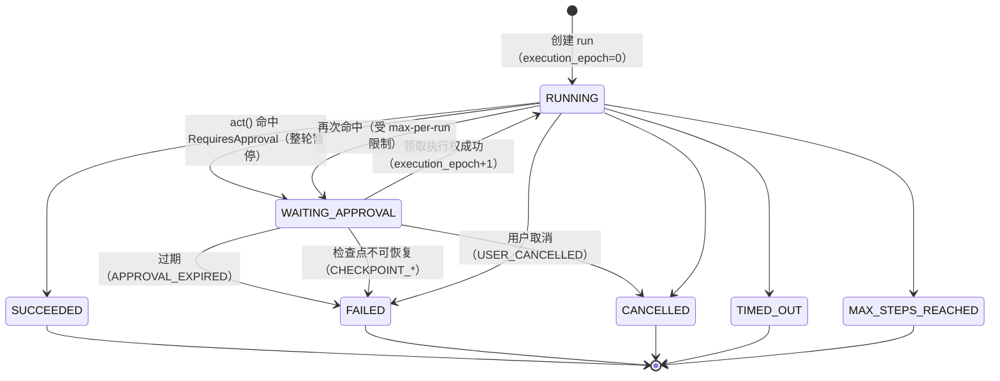
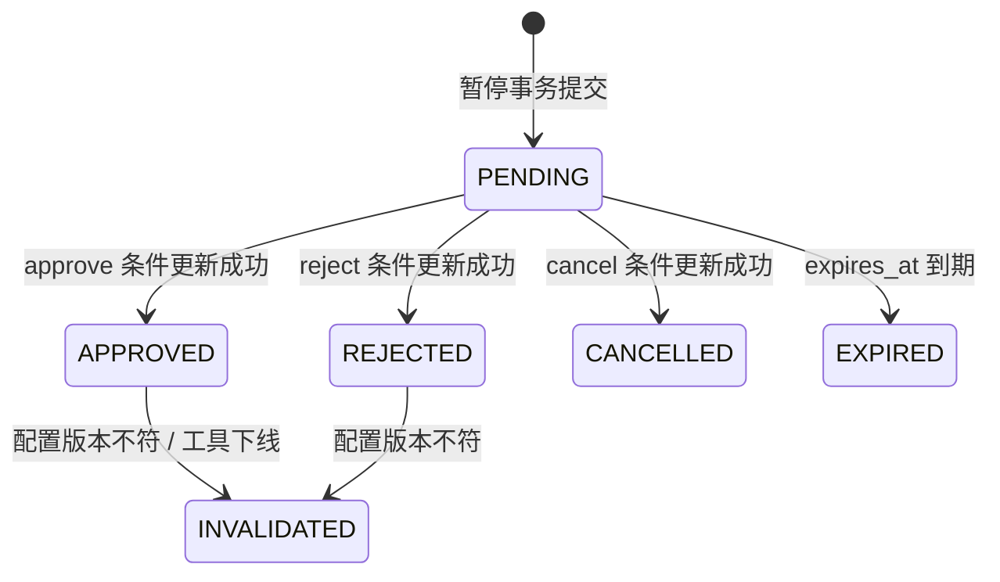
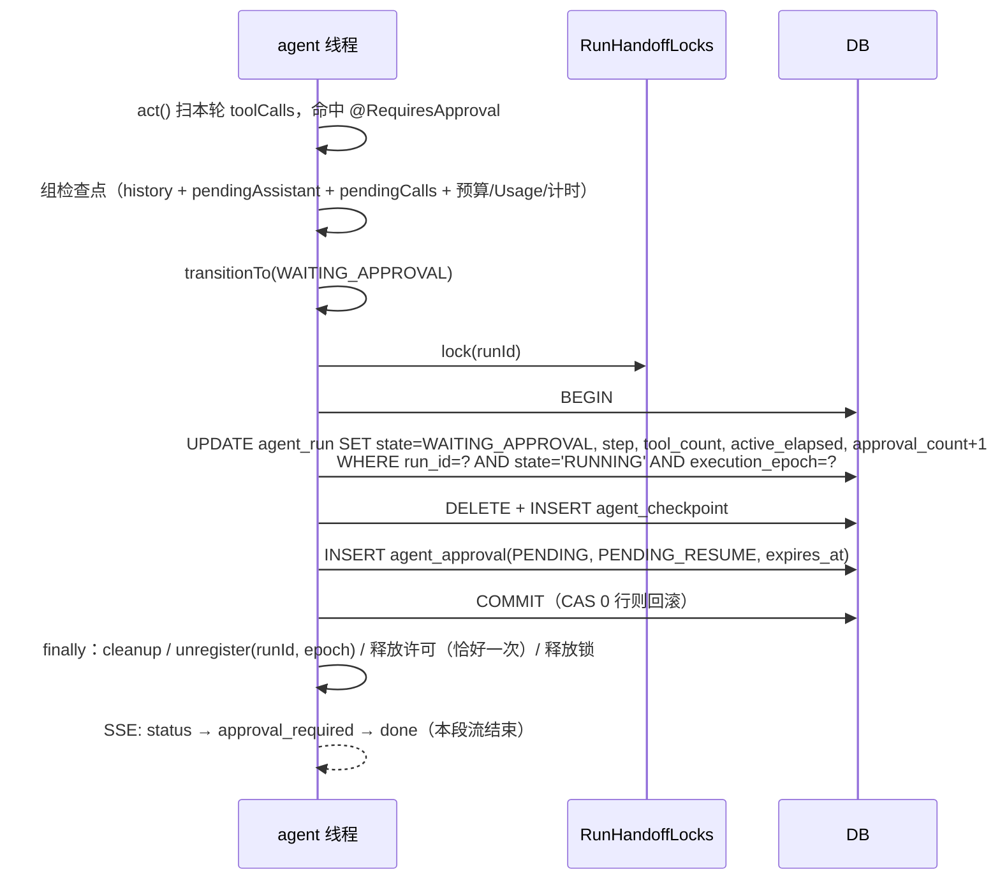

# 审批暂停与恢复（M3）设计

> 状态：批次 1 已实现，批次 2–4 待实现。
> 范围：`create_playlist`、`add_songs_to_playlist` 两个写工具；单实例；只恢复"审批暂停点"，不恢复任意步骤。

## 1. 目标与非目标

**目标**：写工具执行前暂停 → 用户批准/拒绝 → 恢复执行；暂停期间进程重启后仍可从检查点继续。

**非目标**：多 Agent、长期记忆、上下文压缩、任意执行点恢复、分布式锁、审批前端页面、`rename/delete/remove_song`、真实认证。

## 2. 状态模型

### 2.1 run 状态



`WAITING_APPROVAL` **不是终态**，但只允许转到 `RUNNING / FAILED / CANCELLED`；`RUNNING → WAITING_APPROVAL` 允许。
`transitionTo` 对终态的保护不变。

### 2.2 approval 状态与执行子状态

决定（`status`）与执行（`resume_state`）**分开存**，这是"决定与执行分离"的落点：



`resume_state` 的四个阶段（与用户口径一致）：

| resume_state | 含义 | run.state | 崩溃后处理 |
|---|---|---|---|
| `PENDING_RESUME` | 决定已持久化，**待领取** | `WAITING_APPROVAL` | 扫描/`POST /resume` 重新领取 |
| `CLAIMED` | 已领取执行权（锁 + 许可 + epoch），**尚未提交执行** | `RUNNING`（新 epoch） | 进程重启：**安全回退**到 `PENDING_RESUME`（任务线程从未启动，不可能写业务数据） |
| `RUNNING` | 已启动（任务线程已开始执行） | `RUNNING`（新 epoch） | 进程重启：`FAILED` + `PROCESS_RESTART`（可能已写，不自动恢复） |
| `FINISHED` / `FAILED` | 执行结束 | 终态 | 不再处理 |

**关键约束**：approve 事务**不**把 run 改成 `RUNNING`。决定持久化后 run 仍是 `WAITING_APPROVAL`，直到领取成功才 CAS 到 `RUNNING`。
这样"已批准但尚未执行"与"正在执行"在数据库里可区分，启动清理不会把前者误判为 `FAILED`。

### 2.3 不变量

| 不变量 | 强制点 |
|---|---|
| 一个 run 同一 step 最多一条 approval | `UNIQUE (run_id, step)` |
| 同一时刻只有一个执行代次 | 进程内按 runId 互斥 + `execution_epoch` CAS |
| 暂停行 `finished_at IS NULL` | `recordPause` 不写该列；`recordFinish` 对暂停直接返回 |
| 未批准绝不写业务表 | 拦截点在 `executeToolCalls` 之前 |
| 批准不可替换工具/参数 | 接口只收 `approvalId`；执行只读检查点 |
| 旧代次不得覆盖新代次 | 所有执行期写库带 `execution_epoch` 条件 |

## 3. 表结构

### 3.1 `agent_run` 新增列

```sql
ALTER TABLE agent_run ADD COLUMN IF NOT EXISTS error_code VARCHAR(64);
ALTER TABLE agent_run ADD COLUMN IF NOT EXISTS execution_epoch INT NOT NULL DEFAULT 0;
ALTER TABLE agent_run ADD COLUMN IF NOT EXISTS config_version VARCHAR(64);
ALTER TABLE agent_run ADD COLUMN IF NOT EXISTS active_elapsed_millis BIGINT NOT NULL DEFAULT 0;
ALTER TABLE agent_run ADD COLUMN IF NOT EXISTS approval_count INT NOT NULL DEFAULT 0;
CREATE INDEX IF NOT EXISTS idx_agent_run_error_code ON agent_run (error_code);
```

稳定原因码（前端只认码，不解析中文）：

| code | 场景 | 终态 |
|---|---|---|
| `APPROVAL_EXPIRED` | 审批超时 | `FAILED` |
| `USER_CANCELLED` | 用户取消 | `CANCELLED` |
| `PROCESS_RESTART` | 重启时残留 `RUNNING` | `FAILED` |
| `CHECKPOINT_CONFIG_MISMATCH` | 配置版本不兼容 | `FAILED` |
| `CHECKPOINT_CORRUPT` | 反序列化失败/版本不支持 | `FAILED` |
| `RESUME_FAILED` | 恢复重试超上限 | `FAILED` |
| `IDEMPOTENCY_CONFLICT` | 同键不同参数 | 该工具失败，run 继续 |
| `BUDGET_EXHAUSTED_ON_RESUME` | 恢复时剩余时间 ≤ 0 | `TIMED_OUT` |
| `APPROVAL_DISABLED` | 审批关闭但命中写工具 | `FAILED` |

### 3.2 `agent_approval`

```sql
CREATE TABLE IF NOT EXISTS agent_approval
(
    approval_id      VARCHAR(64)  NOT NULL,
    run_id           VARCHAR(64)  NOT NULL,
    user_id          VARCHAR(64)  NOT NULL,
    agent_type       VARCHAR(32)  NOT NULL,
    step             INT          NOT NULL,
    primary_tool     VARCHAR(64)  NOT NULL,
    tool_count       INT          NOT NULL,
    args_hash        VARCHAR(64)  NOT NULL,
    summary_text     VARCHAR(500) NOT NULL,
    summary_json     TEXT,
    status           VARCHAR(16)  NOT NULL,
    resume_state     VARCHAR(16)  NOT NULL DEFAULT 'PENDING_RESUME',
    resume_attempts  INT          NOT NULL DEFAULT 0,
    decided_at       TIMESTAMP,
    expires_at       TIMESTAMP    NOT NULL,
    created_at       TIMESTAMP    NOT NULL DEFAULT CURRENT_TIMESTAMP,
    updated_at       TIMESTAMP    NOT NULL DEFAULT CURRENT_TIMESTAMP,
    CONSTRAINT pk_agent_approval PRIMARY KEY (approval_id)
);
CREATE UNIQUE INDEX IF NOT EXISTS uk_agent_approval_run_step ON agent_approval (run_id, step);
CREATE INDEX IF NOT EXISTS idx_agent_approval_pending ON agent_approval (status, expires_at);
CREATE INDEX IF NOT EXISTS idx_agent_approval_resume ON agent_approval (resume_state);
CREATE INDEX IF NOT EXISTS idx_agent_approval_user ON agent_approval (user_id);
```

### 3.3 `agent_checkpoint`

```sql
CREATE TABLE IF NOT EXISTS agent_checkpoint
(
    run_id           VARCHAR(64) NOT NULL,
    schema_version   INT         NOT NULL,
    config_version   VARCHAR(64) NOT NULL,
    payload_json     TEXT        NOT NULL,
    created_at       TIMESTAMP   NOT NULL DEFAULT CURRENT_TIMESTAMP,
    updated_at       TIMESTAMP   NOT NULL DEFAULT CURRENT_TIMESTAMP,
    CONSTRAINT pk_agent_checkpoint PRIMARY KEY (run_id)
);
```

### 3.4 `music_tool_idempotency`（批次 3 使用）

```sql
ALTER TABLE music_tool_idempotency ADD COLUMN IF NOT EXISTS status VARCHAR(16) NOT NULL DEFAULT 'DONE';
```

## 4. 检查点

| 字段 | 说明 |
|---|---|
| `schemaVersion` | JSON 结构版本，当前 `1`；不认识 → `CHECKPOINT_CORRUPT` |
| `configVersion` | 见 §4.2；恢复必须**精确相等** |
| `runId / userId / agentType` | 身份与归属 |
| `step / toolCallCount` | 暂停时已计步（该轮计入），恢复**不再 +1** |
| `messages` | 本轮**之前**的历史（**不含** pending assistant） |
| `pendingAssistant` | `role/text/toolCalls`，恢复时**只追加一次** |
| `pendingToolCalls` | `id/type/name/arguments/argsHash` |
| `budget` | `maxSteps / maxToolCalls / timeoutSeconds`（任务预算快照） |
| `usage` | `model / promptTokens / completionTokens / totalTokens / modelCallCount / totalModelCallMillis` |
| `timing` | `originalStartedAt / activeElapsedMillis` |
| `whitelistHash` | 暂停时白名单工具名集合哈希 |

**为什么必须存 `pendingAssistant`**：`ToolCallAgent.act()` 执行 `executeToolCalls` 之前，`ctx.messages` 里**没有**本轮 Assistant(toolCalls)——它由 `ToolCallingManager` 在执行时追加。只存 history 会导致恢复后 `toolCallId` 配对断裂。

**恢复时的用法（易错点）**：用 `messages` 构造 Prompt，把 `pendingAssistant` 包装成 `ChatResponse` 交给 `executeToolCalls`，由框架追加**一次**。
**不要**先把它 add 进 `messages`——那样 assistant 会出现两次、工具结果与调用对不上。
拒绝路径不执行工具，才由应用手动追加 assistant + 拒绝回执。
`ApprovalCheckpointCodecTest.realToolCallingManagerProducesOneResponsePerCall` 用真实 `ToolCallingManager` 锁住这条。

**为什么不存 system prompt 原文**：只存 `configVersion` 指纹。恢复时**不用**新提示词顶替；版本不符即拒绝（`CHECKPOINT_CONFIG_MISMATCH`），让用户重新发起。`agent_run` 不存提示词的约束针对运行记录表，不自动等价于检查点；本期仍按最小必要原则只存指纹。

### 4.2 兼容性版本（R3）

```
configVersion = sha256(
    "contract=" + ToolContractVersion.CURRENT
  + "\nagent=" + agentType
  + "\nprompt=" + promptText                       // 哈希材料，不落原文
  + "\n" + 每个工具（按名排序）: name | description | inputSchema
  + "\napproval=" + 需审批工具名（排序）
)
```

包含：提示词、工具名、参数 Schema、`@RequiresApproval` 标记、显式工具契约版本。
**不包含**预算数值——恢复始终使用任务预算快照，改 `max-steps` 不会让已暂停任务失效。

## 5. 关键流程

### 5.1 暂停（批次 1）



要点：
1. 本轮**一个工具都不执行**（读也不执行），`tool_call_count` 不变；
2. 暂停消耗一步（`nextStep` 已在循环顶部执行），恢复不再 +1；
3. `done` 只表示**本段连接结束**，不表示 run 已终态；终态以 `agent_run.state` 为准；
4. 暂停**不写** `finished_at`。

### 5.2 approve / resume（批次 2）

```
lock(runId) → tryAcquirePermit()（失败 429，不消耗 resume_attempts）
  → TX1: approval PENDING → APPROVED（status='PENDING' AND expires_at>now）
         run 保持 WAITING_APPROVAL，resume_state 保持 PENDING_RESUME
  → TX2（领取）: approval PENDING_RESUME → CLAIMED（CAS）
                run WAITING_APPROVAL → RUNNING, execution_epoch+1（CAS）
  → 提交执行器；任务线程第一条语句：approval CLAIMED → RUNNING
  → 释放锁
```

- 提交执行器失败：`RUNNING → WAITING_APPROVAL`（允许的转换）、`CLAIMED → PENDING_RESUME`、释放许可与锁，返回 503 可重试。
- 崩溃在 `CLAIMED`：任务线程从未启动 → 启动扫描**回退**为 `PENDING_RESUME`，重新领取，不判 `FAILED`。
- 崩溃在 `RUNNING`：`FAILED` + `PROCESS_RESTART`，approval `resume_state=FAILED`。

### 5.3 reject / cancel / 过期

| 动作 | 条件更新 | 结果 |
|---|---|---|
| reject | `status='PENDING' AND expires_at>now` | `REJECTED`；回填拒绝回执后继续；不写业务数据 |
| cancel | `status='PENDING'` | `CANCELLED`；run → `CANCELLED` + `USER_CANCELLED` |
| 过期 | `status='PENDING' AND expires_at<=now` | `EXPIRED`；run → `FAILED` + `APPROVAL_EXPIRED` |

三者**只靠 `UPDATE ... WHERE status='PENDING'` 的受影响行数定胜负**，不做"先查再改"。
输家：`409 ALREADY_APPROVED / ALREADY_REJECTED / ALREADY_CANCELLED`，过期 `410 APPROVAL_EXPIRED`，非本人 `404`。

### 5.4 恢复执行（批次 2）

1. 校验 `schemaVersion` / `configVersion`；
2. 重建 ctx：`messages` 只放检查点里的历史；`pendingAssistant` **不预先 add**，
   而是包装成 `ChatResponse` 交给 `executeToolCalls`，由框架追加一次；
   `step=N` 不增，`usage` 恢复，`activeElapsed` 恢复，`segmentStartedAt=now`，`timeoutBudget=快照`；
3. **先执行已计步的 pending round**，再判断下一轮预算（`currentStep==maxSteps` 时该轮仍必须执行完）；
4. APPROVED：逐条复核 `name ∈ 当前白名单 ∩ 检查点白名单`、`argsHash` 一致、不在重试包装器；全部通过才 `executeToolCalls`；
5. REJECTED：构造与 `toolCallId` 配对的拒绝回执，不执行工具；
6. 任何"检查点/版本/哈希/白名单"不一致 → `INVALIDATED` + **失败关闭**，不执行 pending round，也不"继续循环"。

### 5.5 写入条件按路径分别定义（不是统一要求 `state='RUNNING'`）

统一加 `state='RUNNING'` 会顺手写坏两件事：进度写入会把已进入终态的行改回运行态，
终态写入反而写不进去。因此每条路径的 CAS 条件单独定义：

| 写入路径 | 条件 | 说明 |
|---|---|---|
| `recordStart` | 无（INSERT） | 首次建行，`execution_epoch=0`、`active_elapsed_millis=0`、`approval_count=0` |
| `recordProgress` | `run_id` + `execution_epoch`，且 `ctx.state != WAITING_APPROVAL` | 暂停行由 `recordPause` 与检查点同事务写；进度写入抢在前面会留下"等待审批但没有审批记录"的坏行 |
| `recordPause` | `run_id` + `state='RUNNING'` + `execution_epoch` | 唯一需要"必须是 RUNNING"的路径：暂停的前提是任务正在跑 |
| `recordFinish` | `run_id` + `execution_epoch`，且 `ctx.state != WAITING_APPROVAL` | 不要求 `RUNNING`：正常完成/失败/取消/超时都要能写进去 |
| 领取恢复（批次 2） | `approval.resume_state='PENDING_RESUME'` + `run.state='WAITING_APPROVAL'` | 两条 CAS 在同一事务里，任一失败即整体回滚 |

旧代次不能覆盖新代次靠 `execution_epoch` 相等实现：恢复后 epoch+1，
上一代线程迟到的写入影响 0 行。

### 5.6 批次 1 落实的正确性修正

| 修正 | 落点 |
|---|---|
| 决定与执行不混（`status` / `resume_state` 分离），崩溃窗口 B 可续跑 | §2.2、§8；`agent_approval.resume_state` |
| 代次不是自比较：回调比对**当前句柄对象** | §7；`AgentTaskRegistry.isCurrent` + `BaseAgent.isCurrentExecution` |
| 写入条件按路径区分，不统一要求 `RUNNING` | §5.5；`AgentRunRecorder` 三个方法 |
| 已计步的 pending round 在 `currentStep==maxSteps` 时仍必须执行完 | §5.4 第 3 条、§6；`ApprovalPauseBehaviourTest.pauseStillWorksWhenStepBudgetIsOne`（`maxSteps=1`） |
| `pendingAssistant` 在历史里只出现一次 | §4；`ApprovalCheckpointCodecTest.realToolCallingManagerProducesOneResponsePerCall`（真实 `ToolCallingManager` + 桩工具，断言 4 条消息 / 1 条 assistant / 每个 `toolCallId` 都有配对回执） |

## 6. 时间与预算

```
elapsed(ctx)   = activeElapsed + (segmentStartedAt == null ? 0 : now - segmentStartedAt)
remainingTime  = timeoutBudget - elapsed
remainingSteps = maxSteps - currentStep
remainingTools = maxToolCalls - toolCallCount
```

| 时点 | 动作 |
|---|---|
| 暂停 | `closeExecutionSegment()`；审批等待不计时 |
| 恢复 | `openExecutionSegment()`；`timeoutBudget` 取快照，不读当前 Bean |
| `remainingTime <= 0` | 不发模型调用，`TIMED_OUT` + `BUDGET_EXHAUSTED_ON_RESUME` |
| `remainingSteps <= 0` 且 pending round 已执行完 | `MAX_STEPS_REACHED` + 既有兜底 |

SSE emitter 超时 = **剩余执行时间 + buffer**（不是原始总超时）。

## 7. 执行权与代次

| 机制 | 内容 |
|---|---|
| `RunHandoffLocks` | 按 runId 的引用计数锁；`acquire` 先 `compute` 增引用再 `lock`，`release` 先 `unlock` 再 `compute` 减引用并在 `refs==0 && !isLocked()` 时移除。移除只发生在无人持有时，因此不会出现两把锁同时被持有 |
| `execution_epoch` | 首次执行 0；每次领取 +1 |
| `AgentTaskRegistry` | `register(runId, task)` 拒绝更旧代次；`remove(runId, epoch)` 仅当句柄代次相等才移除 |
| 回调保护 | 回调捕获**自己的句柄引用**，执行前 `registry.get(runId) == myTask` 才继续；不满足则不中断线程、不删任务、不释放许可 |
| 许可 | `tryAcquirePermit()` 返回**代次专属**句柄，`release()` 幂等；旧句柄无法释放新许可 |

### 7.1 审批元数据的扫描与失败关闭

名单只有一个来源：工具方法上的 `@RequiresApproval`。但"注解写对了"不等于"运行时能识别"，
所以扫描结果必须可验证，且不确定时不能放行。

| 项 | 规则 |
|---|---|
| 扫描时机 | `ContextRefreshedEvent`（容器完全启动后），不在构造期：构造期 `getType` 对未实例化的 `@Bean` 工厂方法可能抛异常 |
| 代理 Bean | `ClassUtils.getUserClass(type)` 还原用户类。**不要**用 `AopUtils.getTargetClass(Class)`：它只有 `Object` 重载，传 `Class` 会返回 `java.lang.Class`，导致全表扫不到注解、名单静默变空 |
| 无关 Bean 取类型失败 | 只记 WARN，不阻断启动（这类 Bean 不会被执行，不需要审批元数据） |
| Agent 暴露了扫不到的工具 | **失败关闭**：`verifyExposedTools` 抛异常 → `error_code=APPROVAL_POLICY_INCOMPLETE`，绝不按普通工具执行 |
| 扫描未完成就查询名单 | **失败关闭**：抛异常，不返回空集合（空集合等于"没有工具需要审批"） |
| 生产白名单 | 写工具仍不在任何生产 Agent 的工具列表里；批次 4 才开放 |

验证用两条独立链路（缺一即可能失败放行）：

| 链路 | 测试 | 断言 |
|---|---|---|
| 反射扫描注解 | `WriteToolGuardTest.scanFindsWriteTools` | 预期集合包含 `create_playlist` / `add_songs_to_playlist` |
| 策略扫描（运行时真正生效的那条） | `WriteToolGuardTest.approvalPolicySeesWriteTools` | `requiredToolNames()` 包含两者且非空 |
| 真实链路 | `ApprovalWriteToolPauseIntegrationTest` | 真实写工具 + 真实策略 → 暂停且业务表零变更 |
| 失败关闭 | `ApprovalToolPolicyUnitTest` / `ApprovalToolScanIntegrationTest` | 未就绪、未知工具都抛异常；`@Bean` 工厂与代理实例都能被扫到 |

## 8. 崩溃窗口处理表

| 窗口 | 崩溃后 DB | 处理 |
|---|---|---|
| A. 暂停已提交，未释放许可 | `PENDING` + `WAITING_APPROVAL`，epoch=E | 进程内锁/注册表为空，approve 直接领取 |
| B. 决定已提交，未领取 | `APPROVED` + `PENDING_RESUME` + `WAITING_APPROVAL` | 扫描/`POST /resume` 领取；**不会**被判 `FAILED` |
| C. 已领取，未提交执行 | `APPROVED` + `CLAIMED` + `RUNNING` epoch=E+1 | 启动扫描回退 `PENDING_RESUME` 并重试（线程从未启动，无业务写入） |
| D. 已启动，工具执行中崩溃 | `APPROVED` + `RUNNING` + `RUNNING` | `FAILED` + `PROCESS_RESTART`；查询结果提示"操作可能已生效，请先核对" |
| E. 业务已提交，检查点未更新 | 同 D | 同 D；不承诺新 run 重试一定不重复 |
| F. 暂停事务半提交 | 不可能（单事务） | 若 `WAITING_APPROVAL` 但 approval 缺失 → `CHECKPOINT_CORRUPT` + `FAILED` |
| G. 配置版本不符 | `WAITING_APPROVAL` + 旧版本 | `409 CHECKPOINT_CONFIG_MISMATCH`；approval `INVALIDATED`；run `FAILED` |

## 9. 幂等（批次 3）

同一 `@Transactional` 内：占位 → 业务写入 → `status='DONE' + result_json`。

```
INSERT ... ON CONFLICT (user_id, idempotency_key) DO NOTHING
  0 行 → SELECT ... FOR UPDATE
          hash 不同 → IDEMPOTENCY_CONFLICT（失败关闭）
          status='DONE' → 回放 result_json
          其它 → 失败关闭（绝不回放未完成结果）
业务写入 → UPDATE status='DONE', result_json
```

- 异常穿过事务边界回滚后，**外层**再转脱敏工具结果；事务内不 catch 转 `ok=false`。
- 并发命中在唯一索引处阻塞，提交后读到 `DONE` 才回放。
- `@Transactional` 必须跨 Bean 调用才走代理：`MusicPlaylistWriteService` 是独立 `@Service`，由 `IdempotentWriteExecutor` 注入调用；测试断言 `AopUtils.isAopProxy`。
- H2 与 PG 差异：`ON CONFLICT` 需真实执行验证（不以 Parser 符号为证据）；`@Tag("pg")` 用例**在默认构建中显式排除**，PG 验证使用隔离测试数据，不删现有示例业务数据。

## 10. 审批摘要与安全

| 项 | 规则 |
|---|---|
| `summary_text` | ≤500 字符；控制字符折叠为空格；只含动作名、歌单名、歌曲数量、前 5 首标题、有效期 |
| `summary_json` | 结构化同上；`songs` 最多 5 条 + "等 N 首" |
| 绝不出现 | 参数原文 JSON、userId、密钥、URL、异常 |
| 绑定 | `args_hash = sha256(canonicalJson(整轮 pending calls，按顺序))` |
| 接口 | 只接受 `approvalId`，不接受任何工具名/参数 |
| 恢复 | 重新校验歌单归属、曲库存在性；批准不代表永久授权 |

## 11. 接口契约（批次 2）

| 方法 | 路径 | 说明 |
|---|---|---|
| POST | `/api/ai/approvals/{id}/approve` | `SseEmitter` 续流 |
| POST | `/api/ai/approvals/{id}/reject` | `SseEmitter` 续流 |
| POST | `/api/ai/approvals/{id}/resume` | 幂等；`PENDING_RESUME` / `CLAIMED` 可重试 |
| GET | `/api/ai/approvals/{id}` | 状态 + 摘要 + 有效期 |
| GET | `/api/ai/runs/{runId}` | 现有接口 + `errorCode / activeElapsedMillis / approval` |
| POST | `/api/ai/runs/{runId}/cancel` | 现有接口 + `WAITING_APPROVAL` 分支 |

后台恢复不创建无人接收的 SSE：`resume(approvalId, emitter=null)` 时只落库，用户通过查询接口读结果。

## 12. 测试清单

| # | 用例 | 断言 |
|---|---|---|
| 1 | 未批准不写入 | 业务表相对快照无变更；`tool_call_count` 不变 |
| 2 | 整轮暂停 | `[读, 写]` 混合轮：读也未执行 |
| 3 | 批准成功 | 落库；`SUCCEEDED`；SSE 与 DB 一致 |
| 4 | 拒绝 | 无业务变更；每个 `toolCallId` 有拒绝回执 |
| 5 | 重复/并发批准 | 恰好一个赢；只写一次 |
| 6 | 越权 | 404；无业务变更 |
| 7 | 取消 vs 批准 | 恰好一个赢 |
| 8 | 许可 | 暂停后 `available == max`；恰好释放一次 |
| 9 | 暂停重启恢复 | 只留 DB 也能续跑；step 不自增 |
| 10 | 过期 | `FAILED` + `APPROVAL_EXPIRED` |
| 11 | 配置版本不符 | `INVALIDATED`；不执行 pending round |
| 12 | 幂等重放/冲突/回滚 | 一次写入；回滚后两表都干净 |
| 13 | 崩溃窗口 B/C/D | B 可续跑；C 回退重试；D 标 `PROCESS_RESTART` |
| 14 | 旧句柄 | 旧代次 remove/finish 不影响新代次 |
| 15 | 审批次数上限 | 达上限不再暂停 |
| 16 | 摘要脱敏 | 无参数原文/密钥；控制字符折叠 |
| 17 | 真实写工具链路 | 真实注解 + 真实策略 → 暂停；`music_playlist` 相对快照零变更 |
| 18 | 扫描失败关闭 | 未就绪 / 未知工具 → 抛异常，不按普通工具执行 |
| 19 | 暂停事务故障 | 审批插入撞唯一索引 → 三表全回滚；`ctx` 不残留 `WAITING_APPROVAL`；SSE 不发 `approval_required` |

## 13. 实现批次

| 批次 | 内容 | 状态 |
|---|---|---|
| 1 | `WAITING_APPROVAL`、检查点 DTO/编解码、计时与预算快照、epoch/句柄保护、暂停事务与 `recordPause`、审批摘要、暂停 SSE 出口 | **已实现** |
| 2 | approve/reject/resume 接口、条件更新、领取与代次、续流、查询接口、cancel 扩展 | 待实现 |
| 3 | 幂等执行器、`status` 列、并发/回滚/代理测试、PG 隔离验证 | 待实现 |
| 4 | 白名单开放、`WriteToolGuardTest` 调整、提示词、启动扫描与 30s 扫描、文档与手动复测 | 待实现 |
