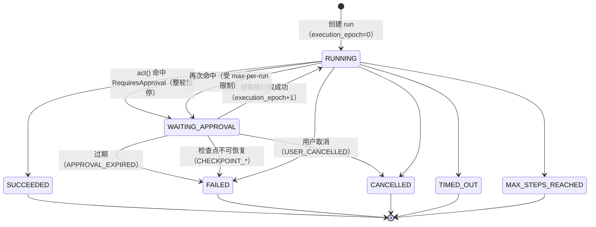
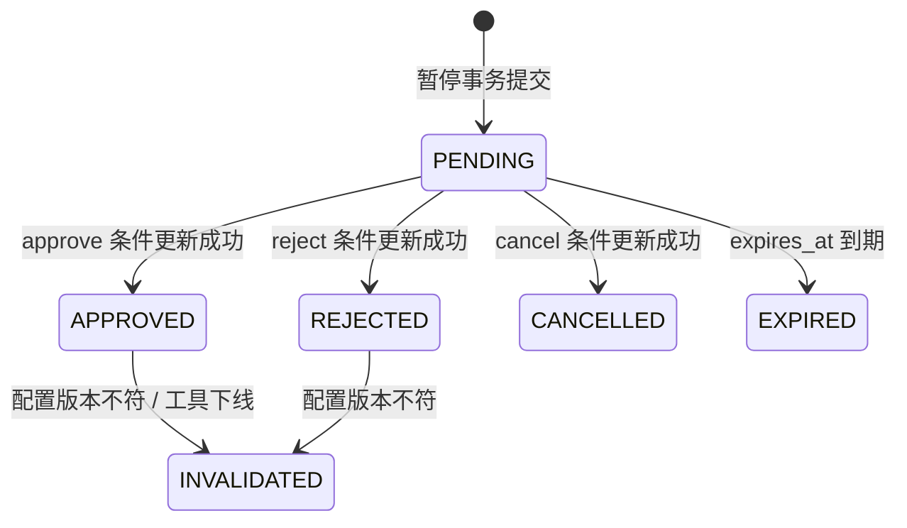
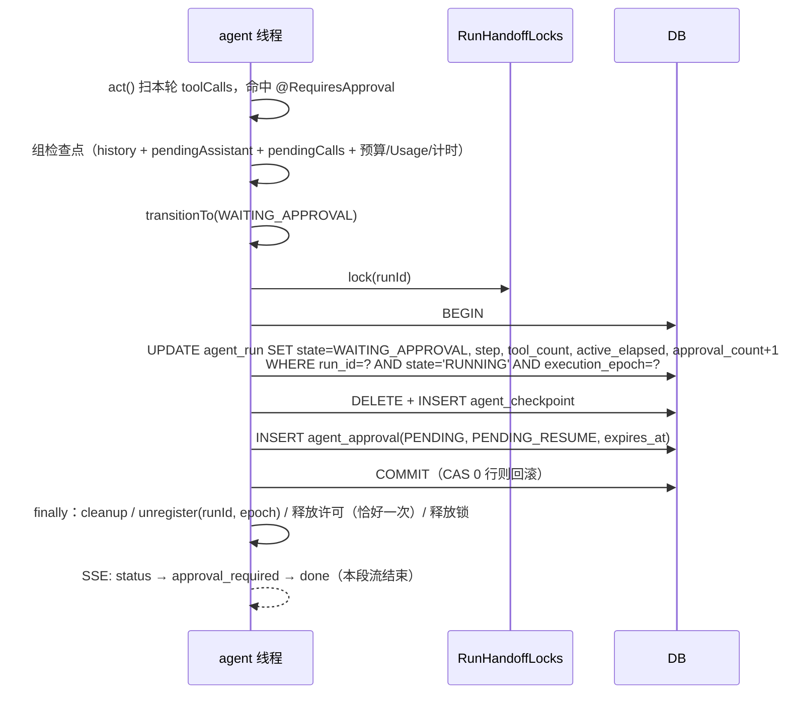

# 审批暂停与恢复（M3）设计

> 状态：批次 1 已实现，批次 2–4 待实现。
> 范围：`create_playlist`、`add_songs_to_playlist` 两个写工具；单实例；只恢复"审批暂停点"，不恢复任意步骤。

## 1. 目标与非目标

**目标**：写工具执行前暂停 → 用户批准/拒绝 → 恢复执行；暂停期间进程重启后仍可从检查点继续。

**非目标**：多 Agent、长期记忆、上下文压缩、任意执行点恢复、分布式锁、审批前端页面、`rename/delete/remove_song`、真实认证。

## 2. 状态模型

### 2.1 run 状态



`WAITING_APPROVAL` **不是终态**，但只允许转到 `RUNNING / FAILED / CANCELLED`；`RUNNING → WAITING_APPROVAL` 允许。
`transitionTo` 对终态的保护不变。

### 2.2 approval 状态与执行子状态

决定（`status`）与执行（`resume_state`）**分开存**，这是"决定与执行分离"的落点：



`resume_state` 的四个阶段（与用户口径一致）：

| resume_state | 含义 | run.state | 崩溃后处理 |
|---|---|---|---|
| `PENDING_RESUME` | 决定已持久化，**待领取** | `WAITING_APPROVAL` | 扫描/`POST /resume` 重新领取 |
| `CLAIMED` | 已领取执行权（锁 + 许可 + epoch），**尚未提交执行** | `RUNNING`（新 epoch） | 进程重启：可安全回退到 `PENDING_RESUME`（任务线程从未启动，不可能写业务数据）——**该回退由批次 4 的扫描器实现，本批只有手动 `/resume` 与补偿路径** |
| `RUNNING` | 已启动（任务线程已开始执行） | `RUNNING`（新 epoch） | 进程重启：`FAILED` + `PROCESS_RESTART`（可能已写，不自动恢复） |
| `FINISHED` / `FAILED` | 执行结束 | 终态 | 不再处理 |

**关键约束**：approve 事务**不**把 run 改成 `RUNNING`。决定持久化后 run 仍是 `WAITING_APPROVAL`，直到领取成功才 CAS 到 `RUNNING`。
这样"已批准但尚未执行"与"正在执行"在数据库里可区分，启动清理不会把前者误判为 `FAILED`。

### 2.3 不变量

| 不变量 | 强制点 |
|---|---|
| 一个 run 同一 step 最多一条 approval | `UNIQUE (run_id, step)` |
| 同一时刻只有一个执行代次 | 进程内按 runId 互斥 + `execution_epoch` CAS |
| 暂停行 `finished_at IS NULL` | `recordPause` 不写该列；`recordFinish` 对暂停直接返回 |
| 未批准绝不写业务表 | 拦截点在 `executeToolCalls` 之前 |
| 批准不可替换工具/参数 | 接口只收 `approvalId`；执行只读检查点 |
| 旧代次不得覆盖新代次 | 所有执行期写库带 `execution_epoch` 条件 |

## 3. 表结构

### 3.1 `agent_run` 新增列

```sql
ALTER TABLE agent_run ADD COLUMN IF NOT EXISTS error_code VARCHAR(64);
ALTER TABLE agent_run ADD COLUMN IF NOT EXISTS execution_epoch INT NOT NULL DEFAULT 0;
ALTER TABLE agent_run ADD COLUMN IF NOT EXISTS config_version VARCHAR(64);
ALTER TABLE agent_run ADD COLUMN IF NOT EXISTS active_elapsed_millis BIGINT NOT NULL DEFAULT 0;
ALTER TABLE agent_run ADD COLUMN IF NOT EXISTS approval_count INT NOT NULL DEFAULT 0;
CREATE INDEX IF NOT EXISTS idx_agent_run_error_code ON agent_run (error_code);
```

稳定原因码（前端只认码，不解析中文）：

| code | 场景 | 终态 |
|---|---|---|
| `APPROVAL_EXPIRED` | 审批超时 | `FAILED` |
| `USER_CANCELLED` | 用户取消 | `CANCELLED` |
| `PROCESS_RESTART` | 重启时残留 `RUNNING` | `FAILED` |
| `CHECKPOINT_CONFIG_MISMATCH` | 配置版本不兼容 | `FAILED` |
| `CHECKPOINT_CORRUPT` | 反序列化失败/版本不支持 | `FAILED` |
| `RESUME_FAILED` | 恢复重试超上限 | `FAILED` |
| `IDEMPOTENCY_CONFLICT` | 同键不同参数 | 该工具失败，run 继续 |
| `BUDGET_EXHAUSTED_ON_RESUME` | 恢复时剩余时间 ≤ 0 | `TIMED_OUT` |
| `APPROVAL_DISABLED` | 审批关闭但命中写工具 | `FAILED` |

### 3.2 `agent_approval`

```sql
CREATE TABLE IF NOT EXISTS agent_approval
(
    approval_id      VARCHAR(64)  NOT NULL,
    run_id           VARCHAR(64)  NOT NULL,
    user_id          VARCHAR(64)  NOT NULL,
    agent_type       VARCHAR(32)  NOT NULL,
    step             INT          NOT NULL,
    primary_tool     VARCHAR(64)  NOT NULL,
    tool_count       INT          NOT NULL,
    args_hash        VARCHAR(64)  NOT NULL,
    summary_text     VARCHAR(500) NOT NULL,
    summary_json     TEXT,
    status           VARCHAR(16)  NOT NULL,
    resume_state     VARCHAR(16)  NOT NULL DEFAULT 'PENDING_RESUME',
    resume_attempts  INT          NOT NULL DEFAULT 0,
    decided_at       TIMESTAMP,
    expires_at       TIMESTAMP    NOT NULL,
    created_at       TIMESTAMP    NOT NULL DEFAULT CURRENT_TIMESTAMP,
    updated_at       TIMESTAMP    NOT NULL DEFAULT CURRENT_TIMESTAMP,
    CONSTRAINT pk_agent_approval PRIMARY KEY (approval_id)
);
CREATE UNIQUE INDEX IF NOT EXISTS uk_agent_approval_run_step ON agent_approval (run_id, step);
CREATE INDEX IF NOT EXISTS idx_agent_approval_pending ON agent_approval (status, expires_at);
CREATE INDEX IF NOT EXISTS idx_agent_approval_resume ON agent_approval (resume_state);
CREATE INDEX IF NOT EXISTS idx_agent_approval_user ON agent_approval (user_id);
```

### 3.3 `agent_checkpoint`

```sql
CREATE TABLE IF NOT EXISTS agent_checkpoint
(
    run_id           VARCHAR(64) NOT NULL,
    schema_version   INT         NOT NULL,
    config_version   VARCHAR(64) NOT NULL,
    payload_json     TEXT        NOT NULL,
    created_at       TIMESTAMP   NOT NULL DEFAULT CURRENT_TIMESTAMP,
    updated_at       TIMESTAMP   NOT NULL DEFAULT CURRENT_TIMESTAMP,
    CONSTRAINT pk_agent_checkpoint PRIMARY KEY (run_id)
);
```

### 3.4 `music_tool_idempotency`（批次 3 使用）

```sql
ALTER TABLE music_tool_idempotency ADD COLUMN IF NOT EXISTS status VARCHAR(16) NOT NULL DEFAULT 'DONE';
```

## 4. 检查点

| 字段 | 说明 |
|---|---|
| `schemaVersion` | JSON 结构版本，当前 `1`；不认识 → `CHECKPOINT_CORRUPT` |
| `configVersion` | 见 §4.2；恢复必须**精确相等** |
| `runId / userId / agentType` | 身份与归属 |
| `step / toolCallCount` | 暂停时已计步（该轮计入），恢复**不再 +1** |
| `messages` | 本轮**之前**的历史（**不含** pending assistant） |
| `pendingAssistant` | `role/text/toolCalls`，恢复时**只追加一次** |
| `pendingToolCalls` | `id/type/name/arguments/argsHash` |
| `budget` | `maxSteps / maxToolCalls / timeoutSeconds`（任务预算快照） |
| `usage` | `model / promptTokens / completionTokens / totalTokens / modelCallCount / totalModelCallMillis` |
| `timing` | `originalStartedAt / activeElapsedMillis` |
| `whitelistHash` | 暂停时白名单工具名集合哈希 |

**为什么必须存 `pendingAssistant`**：`ToolCallAgent.act()` 执行 `executeToolCalls` 之前，`ctx.messages` 里**没有**本轮 Assistant(toolCalls)——它由 `ToolCallingManager` 在执行时追加。只存 history 会导致恢复后 `toolCallId` 配对断裂。

**恢复时的用法（易错点）**：用 `messages` 构造 Prompt，把 `pendingAssistant` 包装成 `ChatResponse` 交给 `executeToolCalls`，由框架追加**一次**。
**不要**先把它 add 进 `messages`——那样 assistant 会出现两次、工具结果与调用对不上。
拒绝路径不执行工具，才由应用手动追加 assistant + 拒绝回执。
`ApprovalCheckpointCodecTest.realToolCallingManagerProducesOneResponsePerCall` 用真实 `ToolCallingManager` 锁住这条。

**为什么不存 system prompt 原文**：只存 `configVersion` 指纹。恢复时**不用**新提示词顶替；版本不符即拒绝（`CHECKPOINT_CONFIG_MISMATCH`），让用户重新发起。`agent_run` 不存提示词的约束针对运行记录表，不自动等价于检查点；本期仍按最小必要原则只存指纹。

### 4.2 兼容性版本（R3）

```
configVersion = sha256(
    "contract=" + ToolContractVersion.CURRENT
  + "\nagent=" + agentType
  + "\nprompt=" + promptText                       // 哈希材料，不落原文
  + "\n" + 每个工具（按名排序）: name | description | inputSchema
  + "\napproval=" + 需审批工具名（排序）
)
```

包含：提示词、工具名、参数 Schema、`@RequiresApproval` 标记、显式工具契约版本。
**不包含**预算数值——恢复始终使用任务预算快照，改 `max-steps` 不会让已暂停任务失效。

## 5. 关键流程

### 5.1 暂停（批次 1）



要点：
1. 本轮**一个工具都不执行**（读也不执行），`tool_call_count` 不变；
2. 暂停消耗一步（`nextStep` 已在循环顶部执行），恢复不再 +1；
3. `done` 只表示**本段连接结束**，不表示 run 已终态；终态以 `agent_run.state` 为准；
4. 暂停**不写** `finished_at`。

### 5.2 approve / reject / resume（批次 2，已实现）

**HTTP 契约是一次调用**：`POST /approve`（或 `/reject`）落决定后**立即尝试恢复**并返回续流。
用户点一次"批准"就应该看到这次执行的结果，而不是再点一次"恢复"。

**内部职责仍然分离**：决定是持久化事实，恢复是领取执行权。
`/resume` 不是第二条必经路径，而是"决定已保存、执行没起来"时的重试入口
（无并发许可 429、执行器拒绝 409、进程重启等）。

```
POST /approve|/reject
  归属校验（不是本人 → 404，只读，不改任何状态）
  TX: approval PENDING → APPROVED|REJECTED（status='PENDING' AND expires_at>now）
      run 保持 WAITING_APPROVAL，resume_state 保持 PENDING_RESUME
  → 继续走下面的"恢复"步骤；决定失败按原状态码返回，决定成功但恢复失败时
    返回恢复的原因码，并在消息里注明"决定已保存，可重试恢复"

POST /resume（或 approve/reject 内部）
  状态校验（未决定 409 / FINISHED 409 / FAILED 409 / CLAIMED·RUNNING 409）
  → 启动期限（decided_at + resume-start-timeout 已过 → FAILED + APPROVAL_RESUME_TIMEOUT，410）
  → 找 Agent（找不到 → 503，不改状态，部署修好后可重试）
  → 检查点校验（失败 → INVALIDATED + FAILED，409）
  → TX（领取）: approval PENDING_RESUME → CLAIMED, claimed_epoch=epoch+1
               run WAITING_APPROVAL → RUNNING, execution_epoch=epoch+1
  → tryAcquirePermit()（失败 → 补偿回 PENDING_RESUME，429，不计失败次数）
  → 构建 ctx → 登记句柄 → 提交执行器
  → **任务体第一条语句**：markStarted（CLAIMED → RUNNING，条件 approvalId+epoch，0 行即退出）
  → 之后才开始模型/工具
```

- **启动标记在执行线程里，不在提交之前**：提交成功只代表"进了队列"。
  排队期间库里是 `CLAIMED`，真正开始执行才变 `RUNNING`——
  这样"已提交但没跑"和"正在执行"可区分，超期未启动也能被识别。
- 提交执行器失败 / 登记失败：异步体一行都没跑，`RUNNING → WAITING_APPROVAL`、
  `CLAIMED → PENDING_RESUME`、清空 `claimed_epoch`、释放许可，返回 409 `RESUME_SUBMIT_FAILED` 可重试。**代次不回退**。
- 启动标记异常：**不能断言"库里仍是 CLAIMED"**。异常只说明应用没拿到这次写入的确认，
  提交可能已生效而确认丢失。本次执行到此为止（不调模型、不执行工具），
  补偿只对 `CLAIMED + 本次代次` 生效；实际已是 `RUNNING` 时补偿影响 0 行并整体放弃，
  不伪造完成，状态不确定的记录留给后续恢复机制按实际状态收尾。
  启动标记 0 行：领取已不属于本次代次，**不写终态、不补偿**，只清理句柄与许可。
- **补偿只吃 `CLAIMED`**：`resume_state='CLAIMED' AND claimed_epoch=本次代次` 在数据库层面等价于
  "还没有越过执行起点"（启动标记是任务体第一条语句）。一旦标记提交（`RUNNING`），
  补偿的 CAS 影响 0 行并整体放弃，已开始的执行不会被回退。
  两步在**同一事务**：第一步 0 行直接返回；第一步成功而第二步 0 行时，
  只有"run 已是 `WAITING_APPROVAL` 且代次仍是本次代次"（别人已补偿，等价目标状态）按幂等接受，
  其余情况抛异常回滚第一步，绝不提交"审批退回、run 没退"的半截补偿。
- 崩溃在 `CLAIMED`：本批**不**自动重领（避免与仍在执行的领取者并行），
  `requireResumable` 对"`CLAIMED`/`RUNNING` 且没有活跃句柄"一律返回
  `409 RESUME_IN_PROGRESS`——**期限内与期限后都一样**，不猜、不自动改状态；
  自动重领与超期收尾留给批次 4 的扫描器。
- 崩溃在 `RUNNING`：由批次 4 的扫描器按 `PROCESS_RESTART` 收尾。

### 5.3 reject / cancel / 过期

| 动作 | 条件更新 | 结果 |
|---|---|---|
| reject | `status='PENDING' AND expires_at>now` | `REJECTED`；回填拒绝回执后继续；不写业务数据 |
| cancel | `status='PENDING'` | `CANCELLED`；run → `CANCELLED` + `USER_CANCELLED` |
| 过期 | `status='PENDING' AND expires_at<=now` | `EXPIRED`；run → `FAILED` + `APPROVAL_EXPIRED` |

三者**只靠 `UPDATE ... WHERE status='PENDING'` 的受影响行数定胜负**，不做"先查再改"。
输家：`409 ALREADY_APPROVED / ALREADY_REJECTED / ALREADY_CANCELLED`，过期 `410 APPROVAL_EXPIRED`，非本人 `404`。

### 5.4 恢复执行（批次 2）

1. 校验 `schemaVersion` / `configVersion`；
2. 重建 ctx：`messages` 只放检查点里的历史；`pendingAssistant` **不预先 add**，
   而是包装成 `ChatResponse` 交给 `executeToolCalls`，由框架追加一次；
   `step=N` 不增，`usage` 恢复，`activeElapsed` 恢复，`segmentStartedAt=now`，`timeoutBudget=快照`；
3. **先执行已计步的 pending round**，再判断下一轮预算（`currentStep==maxSteps` 时该轮仍必须执行完）；
4. APPROVED：逐条复核 `name ∈ 当前白名单 ∩ 检查点白名单`、`argsHash` 一致、不在重试包装器；全部通过才 `executeToolCalls`；
5. REJECTED：构造与 `toolCallId` 配对的拒绝回执，不执行工具；
6. 任何"检查点/版本/哈希/白名单"不一致 → `INVALIDATED` + **失败关闭**，不执行 pending round，也不"继续循环"。
7. 批准路径执行前先看两个额度：剩余执行时间（`elapsed >= effectiveTimeout` → `BUDGET_EXHAUSTED_ON_RESUME` + `TIMED_OUT`）、
   剩余工具额度（不足 → `TOOL_BUDGET_INSUFFICIENT` + `MAX_STEPS_REACHED`，**整轮放弃**，绝不执行一半）；
   拒绝路径不看工具额度、不增加 `toolCallCount`。
8. 恢复流断开**不取消**任务：`onCompletion` 在 `resumed=true` 时只记日志，
   不注销句柄、不释放许可，任务在后台跑完，结果通过 `agent_run` 查询；
   普通 `runStream` 的断连取消语义保持不变。真正的执行预算超时（`onTimeout`）仍按任务超时处理。

### 5.5 写入条件按路径分别定义（不是统一要求 `state='RUNNING'`）

统一加 `state='RUNNING'` 会顺手写坏两件事：进度写入会把已进入终态的行改回运行态，
终态写入反而写不进去。因此每条路径的 CAS 条件单独定义：

| 写入路径 | 条件 | 说明 |
|---|---|---|
| `recordStart` | 无（INSERT） | 首次建行，`execution_epoch=0`、`active_elapsed_millis=0`、`approval_count=0` |
| `recordProgress` | `run_id` + `execution_epoch`，且 `ctx.state != WAITING_APPROVAL` | 暂停行由 `recordPause` 与检查点同事务写；进度写入抢在前面会留下"等待审批但没有审批记录"的坏行 |
| `recordPause` | `run_id` + `state='RUNNING'` + `execution_epoch` | 唯一需要"必须是 RUNNING"的路径：暂停的前提是任务正在跑 |
| `recordFinish` | `run_id` + `execution_epoch`，且 `ctx.state != WAITING_APPROVAL` | 不要求 `RUNNING`：正常完成/失败/取消/超时都要能写进去 |
| 领取恢复（批次 2） | `approval.resume_state='PENDING_RESUME'` + `run.state='WAITING_APPROVAL'` | 两条 CAS 在同一事务里，任一失败即整体回滚 |

旧代次不能覆盖新代次靠 `execution_epoch` 相等实现：恢复后 epoch+1，
上一代线程迟到的写入影响 0 行。

### 5.6 批次 1 落实的正确性修正

| 修正 | 落点 |
|---|---|
| 决定与执行不混（`status` / `resume_state` 分离），崩溃窗口 B 可续跑 | §2.2、§8；`agent_approval.resume_state` |
| 代次不是自比较：回调比对**当前句柄对象** | §7；`AgentTaskRegistry.isCurrent` + `BaseAgent.isCurrentExecution` |
| 写入条件按路径区分，不统一要求 `RUNNING` | §5.5；`AgentRunRecorder` 三个方法 |
| 已计步的 pending round 在 `currentStep==maxSteps` 时仍必须执行完 | §5.4 第 3 条、§6；`ApprovalPauseBehaviourTest.pauseStillWorksWhenStepBudgetIsOne`（`maxSteps=1`） |
| `pendingAssistant` 在历史里只出现一次 | §4；`ApprovalCheckpointCodecTest.realToolCallingManagerProducesOneResponsePerCall`（真实 `ToolCallingManager` + 桩工具，断言 4 条消息 / 1 条 assistant / 每个 `toolCallId` 都有配对回执） |

### 5.7 批次 2 落实的状态转换（实现口径）

`status`（决定）与 `resume_state`（执行）两列独立推进，任何一步都能从库里读出"现在到底在哪"。

| 触发 | approval.status | approval.resume_state | run.state | run.execution_epoch |
|---|---|---|---|---|
| 暂停（批次 1） | `PENDING` | `PENDING_RESUME` | `WAITING_APPROVAL` | 不变 |
| approve / reject | `APPROVED` / `REJECTED` | `PENDING_RESUME` | `WAITING_APPROVAL` | 不变 |
| 取消暂停任务 | `CANCELLED` | `FAILED` | `CANCELLED` + `USER_CANCELLED` | 不变 |
| 决定过期 | `EXPIRED` | `FAILED` | `FAILED` + `APPROVAL_EXPIRED` | 不变 |
| 领取 | 不变 | `CLAIMED`（写 `claimed_epoch`） | `RUNNING` | **+1** |
| 提交执行器（排队中） | 不变 | 仍 `CLAIMED` | `RUNNING` | 不变 |
| 启动标记（任务体第一句） | 不变 | `RUNNING` | `RUNNING` | 不变 |
| 正常结束 / 交接 | 不变 | `FINISHED`（与 run 终态同事务） | 由任务自身决定（成功/失败/预算） | 不变 |
| 恢复后再次暂停 | 旧 → `FINISHED`；新 → `PENDING` | 旧 `FINISHED`；新 `PENDING_RESUME` | `WAITING_APPROVAL` | 不变 |
| 提交失败 / 无许可 | 不变 | 回 `PENDING_RESUME`（清 `claimed_epoch`） | 回 `WAITING_APPROVAL` | 不回退 |
| 启动期限到期 | 不变 | `FAILED` | `FAILED` + `APPROVAL_RESUME_TIMEOUT` | 不变 |
| 检查点校验失败 | `INVALIDATED` | `FAILED` | `FAILED` + 具体原因码 | 不变 |
| 审批次数触顶 | 不创建新记录 | — | `FAILED` + `APPROVAL_LIMIT_REACHED` | 不变 |

三条容易写错的约束：

1. `FINISHED` 只表示"这条审批不再有执行权"，**不代表业务成功**；业务结果只看工具结果与 `agent_run.state`。
2. 再次暂停时，旧审批由**暂停事务**收尾，不能等"整个 run 终态"——那时 run 仍停在 `WAITING_APPROVAL`。
3. 补偿必须带 `epoch + 预期状态`，且**不回退代次**：代次回退会让旧代次迟到的写入重新生效。

### 5.8 终态与审批收尾的写入顺序

恢复执行的收尾是**一个事务**：`agent_run` 终态与 `approval.resume_state='FINISHED'` 同事务提交
（`ApprovalExecutionCompletionService.complete` 带 `@Transactional`；内部 `recordFinishStrict` 不吞异常，
`claimService.finish` 是 `REQUIRED` 传播，加入同一事务而不是另开一个）。

最终完成（恢复后正常结束）的真实顺序：

```
1. 循环结束，ctx 状态在内存里已是终态
2. persistTerminal（同一事务）
   2.1 UPDATE agent_run SET state=?, finished_at=?, ... WHERE run_id=? AND execution_epoch=?
   2.2 仅当 2.1 影响 1 行：UPDATE agent_approval SET resume_state='FINISHED'
       WHERE approval_id=? AND resume_state IN ('RUNNING','CLAIMED')
   2.3 2.2 影响 0 行时：只有审批已是 FINISHED（重复收尾）按幂等接受；
       其余（PENDING_RESUME / FAILED / 行不存在）抛异常，整个事务回滚
3. 事务提交成功后，才发送 final_answer
4. 再发送 done
5. emitter.complete()（只关闭连接，不代表提交）
6. finally：persistTerminal 已由标记位幂等，只做清理与释放许可
```

写入失败（第 2 步抛异常）时的顺序：

```
1. 不发 final_answer、不发 done——它们会被理解成"执行已成功提交"
2. 发一条脱敏 error："执行结果未能保存，请稍后查询任务状态。"
3. emitter.complete()
4. finally 再试一次 persistTerminal；仍失败则保持 run=RUNNING、审批=RUNNING，
   由批次 4 的扫描器按启动期限 / PROCESS_RESTART 收尾
```

再次暂停（恢复后又命中写工具）的真实顺序：

```
1. ToolCallAgent.pauseForApproval 在**暂停事务**里：
   1.1 recordPause（RUNNING→WAITING_APPROVAL，approval_count+1，不写 finished_at）
   1.2 旧审批（ctx.resumeApprovalId）RUNNING→FINISHED
   1.3 写检查点 + 插入新审批（PENDING / PENDING_RESUME）
   —— persist 返回即已提交；提交失败会抛异常，根本走不到发事件那一步
2. 本段流才发 status → approval_required → done，然后关闭连接
3. finally：persistTerminal 因状态是 WAITING_APPROVAL 而跳过
   （recordFinishStrict 返回 0，审批收尾也不执行——旧审批已在 1.2 收尾）
```

四条约束：

1. **不允许出现"审批 FINISHED、run 未终态"的提交结果**：两条写入同事务，要么都生效要么都不生效。
   提交失败时 run 仍是 `RUNNING`、审批仍是 `RUNNING`，由批次 4 的扫描器收尾，
   不会出现"看起来完成了、其实没落库"的假完成。
2. **不允许静默提交"run 终态、审批未收尾"**：`finish` 的 0 行只有"已是 FINISHED"可按幂等接受，
   其余一律回滚整个事务。
3. **`emitter.complete()` 不保证数据库提交**，它只关闭连接；反过来说，**流结束也不证明提交成功**：
   超时、客户端断开、网络错误、启动失败、持久化失败都会让流结束。
   数据库提交成功同样不保证客户端一定收到成功事件。
4. **`done` 不是"整个 run 已终态"的证据**：审批暂停也发 `done`（只表示本段连接结束），
   终态一律以 `agent_run.state` 为准；再次暂停时 `approval_required` 与 `done` 都在暂停事务提交之后发送。

## 6. 时间与预算

```
elapsed(ctx)   = activeElapsed + (segmentStartedAt == null ? 0 : now - segmentStartedAt)
remainingTime  = timeoutBudget - elapsed
remainingSteps = maxSteps - currentStep
remainingTools = maxToolCalls - toolCallCount
```

| 时点 | 动作 |
|---|---|
| 暂停 | `closeExecutionSegment()`；审批等待不计时 |
| 恢复 | `openExecutionSegment()`；`timeoutBudget` 取快照，不读当前 Bean |
| `remainingTime <= 0` | 不发模型调用，`TIMED_OUT` + `BUDGET_EXHAUSTED_ON_RESUME` |
| `remainingSteps <= 0` 且 pending round 已执行完 | `MAX_STEPS_REACHED` + 既有兜底 |

SSE emitter 超时 = **剩余执行时间 + buffer**（不是原始总超时）。

## 7. 执行权与代次

| 机制 | 内容 |
|---|---|
| `RunHandoffLocks` | 按 runId 的引用计数锁；`acquire` 先 `compute` 增引用再 `lock`，`release` 先 `unlock` 再 `compute` 减引用并在 `refs==0 && !isLocked()` 时移除。移除只发生在无人持有时，因此不会出现两把锁同时被持有 |
| `execution_epoch` | 首次执行 0；每次领取 +1 |
| `AgentTaskRegistry` | `register(runId, task)` 拒绝更旧代次；`remove(runId, epoch)` 仅当句柄代次相等才移除 |
| 回调保护 | 回调捕获**自己的句柄引用**，执行前 `registry.get(runId) == myTask` 才继续；不满足则不中断线程、不删任务、不释放许可 |
| 许可 | `tryAcquirePermit()` 返回**代次专属**句柄，`release()` 幂等；旧句柄无法释放新许可 |

### 7.1 审批元数据的扫描与失败关闭

名单只有一个来源：工具方法上的 `@RequiresApproval`。但"注解写对了"不等于"运行时能识别"，
所以扫描结果必须可验证，且不确定时不能放行。

| 项 | 规则 |
|---|---|
| 扫描时机 | `ContextRefreshedEvent`（容器完全启动后），不在构造期：构造期 `getType` 对未实例化的 `@Bean` 工厂方法可能抛异常 |
| 代理 Bean | `ClassUtils.getUserClass(type)` 还原用户类。**不要**用 `AopUtils.getTargetClass(Class)`：它只有 `Object` 重载，传 `Class` 会返回 `java.lang.Class`，导致全表扫不到注解、名单静默变空 |
| 无关 Bean 取类型失败 | 只记 WARN，不阻断启动（这类 Bean 不会被执行，不需要审批元数据） |
| Agent 暴露了扫不到的工具 | **失败关闭**：`verifyExposedTools` 抛异常 → `error_code=APPROVAL_POLICY_INCOMPLETE`，绝不按普通工具执行 |
| 扫描未完成就查询名单 | **失败关闭**：抛异常，不返回空集合（空集合等于"没有工具需要审批"） |
| 生产白名单 | 写工具仍不在任何生产 Agent 的工具列表里；批次 4 才开放 |

验证用两条独立链路（缺一即可能失败放行）：

| 链路 | 测试 | 断言 |
|---|---|---|
| 反射扫描注解 | `WriteToolGuardTest.scanFindsWriteTools` | 预期集合包含 `create_playlist` / `add_songs_to_playlist` |
| 策略扫描（运行时真正生效的那条） | `WriteToolGuardTest.approvalPolicySeesWriteTools` | `requiredToolNames()` 包含两者且非空 |
| 真实链路 | `ApprovalWriteToolPauseIntegrationTest` | 真实写工具 + 真实策略 → 暂停且业务表零变更 |
| 失败关闭 | `ApprovalToolPolicyUnitTest` / `ApprovalToolScanIntegrationTest` | 未就绪、未知工具都抛异常；`@Bean` 工厂与代理实例都能被扫到 |

## 8. 崩溃窗口处理表

| 窗口 | 崩溃后 DB | 处理 |
|---|---|---|
| A. 暂停已提交，未释放许可 | `PENDING` + `WAITING_APPROVAL`，epoch=E | 进程内锁/注册表为空，approve 直接领取 |
| B. 决定已提交，未领取 | `APPROVED` + `PENDING_RESUME` + `WAITING_APPROVAL` | 扫描/`POST /resume` 领取；**不会**被判 `FAILED` |
| C. 已领取，未提交执行 | `APPROVED` + `CLAIMED` + `RUNNING` epoch=E+1 | 启动扫描回退 `PENDING_RESUME` 并重试（线程从未启动，无业务写入） |
| D. 已启动，工具执行中崩溃 | `APPROVED` + `RUNNING` + `RUNNING` | `FAILED` + `PROCESS_RESTART`；查询结果提示"操作可能已生效，请先核对" |
| E. 业务已提交，检查点未更新 | 同 D | 同 D；不承诺新 run 重试一定不重复 |
| F. 暂停事务半提交 | 不可能（单事务） | 若 `WAITING_APPROVAL` 但 approval 缺失 → `CHECKPOINT_CORRUPT` + `FAILED` |
| G. 配置版本不符 | `WAITING_APPROVAL` + 旧版本 | `409 CHECKPOINT_CONFIG_MISMATCH`；approval `INVALIDATED`；run `FAILED` |

## 9. 幂等（批次 3B：同库音乐写工具）

### 9.1 范围与前提

只覆盖 `create_playlist` / `add_songs_to_playlist` 两个**同库**写工具。
`write_file` / `generate_pdf` / `download_resource` 属于外部或本地文件副作用，
既没有稳定幂等键也没有结果查询能力，**本批不做**，也不宣称 exactly-once。

**"整轮一起批准"不等于"整轮一个事务"。**
审批粒度是整轮（一个写工具触发，整轮都不执行），
但执行时是**每一次逻辑写调用一个独立事务**，不承诺整轮业务原子性。

**生产启用边界不变**：`MusicWriteToolConfig` 只装配幂等包装，
这个 Bean **不进入任何 `AgentType` 白名单**，写工具对模型仍然不可见。
本批只把链路装配好并测透，打开白名单是后续批次的事。

### 9.2 逻辑身份

```
idempotency_key = sha256("v2|u{len}:{userId}|r{runId}|s{step}|c{len}:{toolCallId}")
request_hash    = sha256("{toolName}\n{canonicalJson(args)}")
```

- 身份是 **toolCallId**，不是参数：同名同参的两次独立调用必须各自执行，
  用参数做身份会把它们静默合并；
- **不含 execution_epoch**：epoch 每次恢复 +1，放进身份会让"同一调用跨恢复"变成两条记录；
- `step` 参与身份：`toolCallId` 只在一次模型响应内唯一，跨轮复用同一个 id 时靠它分开；
  暂停轮在恢复后 step 不变（恢复路径不 `nextStep`），身份因此稳定；
- 自由文本字段用**长度前缀**编码，避免 `("ab","c")` 与 `("a","bc")` 拼接碰撞；
- 参数哈希只做一致性校验：同一身份、不同工具名或参数 → `IDEMPOTENCY_CONFLICT`，不执行也不回放。

### 9.3 toolCallId 怎么传到回调

`ToolCallback`（spring-ai-model 1.0.0）只有 `call(String)` / `call(String, ToolContext)`，
**拿不到 toolCallId**（已核对接口签名）。因此：

1. `ToolCallAgent.act()` / `executeApprovedRound()` 在执行前把整轮 `ToolCall`
   登记成 `ToolCallPlan`，绑定到 `ToolCallPlanHolder`（ThreadLocal，finally 里 restore）；
2. 回调按**工具名 + 声明顺序**认领；
3. 认领时再比对一次规范化参数，并校验"仍在登记它的那个线程上"。

**依赖的运行契约**（已核对 `DefaultToolCallingManager` 用 `Iterator` 串行遍历，
无线程池/并行流）：同一线程、按声明顺序、每条 ToolCall 恰好一次回调。

**能被发现的破坏**：换线程（跨线程认领直接拒绝，且不消耗队列）、
乱序且参数不同（参数比对失败）、多调/少调（队列空）、
id 缺失或同轮重复（整轮拒绝）。

**无法发现的残余风险**：同一线程内乱序分发、且两条调用的工具名与参数**完全相同**、
只有 id 不同时，认领只能按队列发号，会把副作用记到另一条调用的身份上。
仅凭 (工具名, 参数) 不可能识别这种交换，**不宣称能识别**；
根治需要框架把 toolCallId 传进回调，超出本批范围。

**缺失 / 空白 / 同轮重复 id**：整轮写工具拒绝执行（不碰数据库、零副作用），
返回稳定脱敏错误。**不做**"用参数派生"的退化——那会把两次真实写操作合并成一次。

### 9.4 一个调用一个事务

```
TX: SET LOCAL lock_timeout（仅 PG，事务级）
    代次/归属/状态守卫（agent_run 行锁 SELECT ... FOR UPDATE）
    INSERT 幂等占位行           ← 第一条写入语句，唯一索引在这里裁决并发
    业务写入（MusicPlaylistWriteService，REQUIRED 加入本事务）
    UPDATE 成功结果，校验影响行数 = 1
    COMMIT
```

- 占位、业务、结果同生共死：提交了就一定有可回放的成功结果；回滚了就一定没有副作用，
  也不会留下"占位但没结果"的残留行；
- 因此**不加 `status` 列**：单事务下"行存在"即"已完成"，中间态不可表达；
- INSERT 必须在业务写入之前：PG 上唯一键冲突会让整个事务 abort，
  只有把可能冲突的语句放最前面，才谈得上"冲突就整体回滚"；
- 工具返回 `ok=false` 信封时，执行器抛内部异常回滚占位行，
  **外层**（事务代理之外）再把原始信封原样还给模型；事务内不 catch 后正常返回；
- 执行入口必须**不在**事务里（回调显式检查并拒绝），否则"回滚后换新事务读赢家结果"不成立。

### 9.5 冲突分类：只认幂等记录插入冲突

只有那一条 `INSERT INTO music_tool_idempotency` 的 `DuplicateKeyException`
被转换成 `IdempotencyRecordConflictException`。
业务表（同名歌单、歌单歌曲主键）的唯一键冲突**不是**幂等命中，
走原有业务错误处理，绝不伪装成回放。

### 9.6 等待有界

- 删除"重试 3×50ms 即可保证有界"的说法：真正的等待发生在数据库的唯一索引上；
- PostgreSQL：事务开头 `SET LOCAL lock_timeout = 5s`（`mkagent.music.idempotency.lock-timeout-millis`），
  **只作用于当前事务**，事务结束自动失效，不污染连接池、不改全局配置；
  超时抛的是锁超时（55P03）而**不是** DuplicateKeyException，
  调用方按"正在处理中，请稍后重试"返回，不重复执行业务；
- H2：**没有** `SET LOCAL`，代码在非 PG 上直接跳过；
  锁等待由连接上的 `LOCK_TIMEOUT` 决定（H2 2.3.232 默认 2000ms，测试数据源未改）。
  两者作用域**不等价**：H2 的 `SET LOCK_TIMEOUT` 是 session 级、回滚也不恢复，
  运行期临时改过会跟着连接回到池里；因此本批在 H2 上不做任何运行期超时设置。

### 9.7 回放

冲突事务回滚之后，用**新事务**读取已提交记录：

- 工具名或 `request_hash` 不符 → 冲突，失败关闭；
- `result_json` 为空、非法、或不是成功信封 → 失败关闭；
  **不删除后重执行**（那等于用一次新副作用掩盖历史不一致）；
- 回放前复核访问权：`agent_run` 仍属于当前用户，且结果涉及的歌单当前仍归当前用户；
  失去访问权返回稳定权限错误，**不代表历史操作被撤销**；
- 回放计入 `tool_call_count`（一次调用就是一次调用），不额外追加工具回执。

### 9.8 旧代次

幂等键不含 epoch，但"能不能写"仍由代次与任务状态决定：

- 事务开头对 `agent_run` 这一行做**加锁读**（`SELECT ... FOR UPDATE`），
  同时校验 `user_id`、`state='RUNNING'`、`execution_epoch == ctx.executionEpoch`；
- 为什么要锁：代次推进是 `UPDATE agent_run SET execution_epoch=? WHERE run_id=?
  AND state='WAITING_APPROVAL'`。普通 SELECT 只证明"读的那一刻还对"，
  读完之后、提交之前代次仍可能被推进，旧执行照样写出副作用。
  加锁后两条路径在同一行上串行化：
  - 写事务先拿锁 → 推进被阻塞到写事务提交；此时 state 是 `RUNNING`，
    推进语句的 `state='WAITING_APPROVAL'` 不成立、影响 0 行。
    即：这次写是在资格失效**之前**完成的合法执行，不是"被拦下的旧执行"；
  - 推进先拿锁 → 写事务读到新代次，守卫失败，零副作用。
- 锁顺序：先锁 `agent_run`，再写幂等表与业务表；没有"先锁业务表再锁 run"的路径，
  因此不引入新的死锁环。
- 只看代次不够：状态不是 `RUNNING`（暂停中、已终态）同样拒绝写入。

### 9.9 结果不明

同库事务保证"业务写入与成功记录同生共死"，但**提交确认可能丢失**：
客户端看到报错不等于数据库回滚。因此：

- 不自动换新身份重试，不清除记录后重执行；
- 同一稳定身份再次合法到达时，由记录裁决是否回放；
- 本批不实现扫描器，也不自动重领卡住的 `RUNNING` 审批。

### 9.10 验证方式

- H2（默认真实事务）：并发同 key 只写一次、业务异常/错误信封共同回滚、
  结果更新 0 行回滚、跨 epoch 身份稳定、回放权限、旧记录失败关闭、
  代次推进被行锁阻塞（线性化）、非 `RUNNING`/非本人任务拒绝写入、
  `AopUtils.isAopProxy`；
- `@Tag("pg")`（默认排除，需真实 PG）：唯一索引上的等待/提交/回滚、
  赢家提交后输家用干净事务读到并回放、aborted 事务不可继续读、
  `SET LOCAL lock_timeout` 生效且不泄漏、超时方无提交、
  行锁阻塞代次推进。运行命令见 `PostgresIdempotencyConcurrencyTest` 类注释；
  用例只建带随机后缀的探针表，**不碰业务表**。
- 现状（2026-11-04）：已在隔离的便携版 PostgreSQL 16.15 上实际执行，
  6 条 `pg` 用例 **6 passed / 0 failed / 0 skipped**；
  证据是**直接 JDBC 探针**（真实等待 332ms 后 23505、锁超时 321ms 后 55P03），
  **不是** `IdempotentWriteExecutor` 的 PG 端到端验证——
  执行器、`@Transactional`、Spring 事务在 PG 上的行为仍只有 H2 覆盖。

## 10. 审批摘要与安全

| 项 | 规则 |
|---|---|
| `summary_text` | ≤500 字符；控制字符折叠为空格；只含动作名、歌单名、歌曲数量、前 5 首标题、有效期 |
| `summary_json` | 结构化同上；`songs` 最多 5 条 + "等 N 首" |
| 绝不出现 | 参数原文 JSON、userId、密钥、URL、异常 |
| 绑定 | `args_hash = sha256(canonicalJson(整轮 pending calls，按顺序))` |
| 接口 | 只接受 `approvalId`，不接受任何工具名/参数 |
| 恢复 | 重新校验歌单归属、曲库存在性；批准不代表永久授权 |

## 11. 接口契约（批次 2）

| 方法 | 路径 | 返回 | 说明 |
|---|---|---|---|
| POST | `/api/ai/approvals/{id}/approve` | `SseEmitter` | 落决定后立即恢复并返回续流；重复决定 → `409 ALREADY_APPROVED` |
| POST | `/api/ai/approvals/{id}/reject` | `SseEmitter` | 同上，回填拒绝回执后继续模型轮；`409 ALREADY_REJECTED` |
| POST | `/api/ai/approvals/{id}/resume` | `SseEmitter` | 重试入口：决定已保存但执行没起来时使用；`CLAIMED/RUNNING` → `409 RESUME_IN_PROGRESS` |
| GET | `/api/ai/approvals/{id}` | JSON | 状态 + 摘要 + 有效期，**不含检查点原文** |
| GET | `/api/ai/runs/{runId}` | JSON | 现有接口（结果以此为准） |
| POST | `/api/ai/runs/{runId}/cancel` | JSON | 新增 `WAITING_APPROVAL` 分支，与 approve/reject 竞争同一条件 |

- approve / reject / resume / query **都只接受 `approvalId`**，不读请求体：批准绑定的是暂停那一刻的整轮参数（`args_hash`），
  允许决定时再传工具名或参数就等于"批准 A、执行 B"。
- 错误统一 `{success:false, code, message}`，`code` 为稳定常量（`APPROVAL_EXPIRED` / `RESUME_IN_PROGRESS` /
  `RESUME_CONCURRENCY_LIMIT` / `CHECKPOINT_*` / `APPROVAL_RESUME_TIMEOUT` 等），客户端按 `code` 分支而不是匹配中文。
- 恢复接口断流不取消任务：结果通过 `/api/ai/runs/{runId}` 查询。

## 12. 测试清单

| # | 用例 | 断言 |
|---|---|---|
| 1 | 未批准不写入 | 业务表相对快照无变更；`tool_call_count` 不变 |
| 2 | 整轮暂停 | `[读, 写]` 混合轮：读也未执行 |
| 3 | 批准成功 | 落库；`SUCCEEDED`；SSE 与 DB 一致 |
| 4 | 拒绝 | 无业务变更；每个 `toolCallId` 有拒绝回执 |
| 5 | 重复/并发批准 | 恰好一个赢；只写一次 |
| 6 | 越权 | 404；无业务变更 |
| 7 | 取消 vs 批准 | 恰好一个赢 |
| 8 | 许可 | 暂停后 `available == max`；恰好释放一次 |
| 9 | 暂停重启恢复 | 只留 DB 也能续跑；step 不自增 |
| 10 | 过期 | `FAILED` + `APPROVAL_EXPIRED` |
| 11 | 配置版本不符 | `INVALIDATED`；不执行 pending round |
| 12 | 幂等重放/冲突/回滚 | 一次写入；回滚后两表都干净 |
| 13 | 崩溃窗口 B/C/D | B 可续跑；C 回退重试；D 标 `PROCESS_RESTART` |
| 14 | 旧句柄 | 旧代次 remove/finish 不影响新代次 |
| 15 | 审批次数上限 | 达上限不再暂停 |
| 16 | 摘要脱敏 | 无参数原文/密钥；控制字符折叠 |
| 17 | 真实写工具链路 | 真实注解 + 真实策略 → 暂停；`music_playlist` 相对快照零变更 |
| 18 | 扫描失败关闭 | 未就绪 / 未知工具 → 抛异常，不按普通工具执行 |
| 19 | 暂停事务故障 | 审批插入撞唯一索引 → 三表全回滚；`ctx` 不残留 `WAITING_APPROVAL`；SSE 不发 `approval_required` |
| 20 | 批准闭环 | 写工具恰好执行一次；`SUCCEEDED`；审批 `FINISHED`；step 不重复计 |
| 21 | 拒绝闭环 | 不执行工具、`toolCallCount` 不变；每个 `toolCallId` 配对拒绝回执；assistant 只出现一次 |
| 22 | 跨用户 | approve/reject/resume/query/cancel 全 404；审批/run/检查点/业务数据快照不变（不置 `INVALIDATED`） |
| 23 | 预算边界 | `maxSteps=1` 仍完成原轮；工具额度 0 时拒绝仍能回填 |
| 24 | 重复恢复 | 第二次 409；模型只调两次；许可不泄漏 |
| 25 | 启动门槛 | 代次不符 → 启动标记 0 行 → 模型/工具零调用、许可归还 |
| 26 | 失败可重试 | 执行器拒绝 / 无并发许可 → 补偿回 `PENDING_RESUME`（决定不变、代次不回退），重试成功 |
| 27 | 启动期限 | 超过 `resume-start-timeout` → 410 + `FAILED` + `APPROVAL_RESUME_TIMEOUT` |
| 28 | 检查点完整性 | 归属篡改 → `CHECKPOINT_OWNER_MISMATCH`；缺失 → `CHECKPOINT_MISSING`；均失败关闭 |
| 29 | 取消暂停任务 | 审批与 run 同时 `CANCELLED`；之后批准 409 |
| 30 | 再次暂停 | 旧审批 `FINISHED`、新审批 `PENDING`、run 仍 `WAITING_APPROVAL`；第二轮可继续走完 |
| 31 | 审批次数触顶 | `FAILED` + `APPROVAL_LIMIT_REACHED`；不建新审批；第二轮不执行 |
| 32 | 续流断开 | 客户端断开后任务仍 `SUCCEEDED` 且结果可查；普通入口语义不变 |

## 13. 实现批次

| 批次 | 内容 | 状态 |
|---|---|---|
| 1 | `WAITING_APPROVAL`、检查点 DTO/编解码、计时与预算快照、epoch/句柄保护、暂停事务与 `recordPause`、审批摘要、暂停 SSE 出口 | **已实现** |
| 2 | approve/reject/resume 接口、条件更新、领取与代次、续流、查询接口、cancel 扩展 | **已实现** |
| 3 | 幂等执行器、`status` 列、并发/回滚/代理测试、PG 隔离验证 | 待实现 |
| 4 | 白名单开放、`WriteToolGuardTest` 调整、提示词、启动扫描与 30s 扫描、文档与手动复测 | 待实现 |
